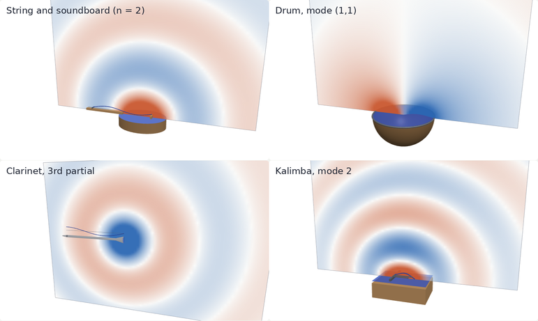

::: {.series-nav .slim}
[The Shape of a Sound](../instruments-as-operators/index.qmd) · [← 2 · What you hear is p(t)](../what-you-hear/index.qmd) · [4 · Why instruments sound different →](../why-instruments-differ/index.qmd) · [Glossary](../instruments-as-operators/glossary.qmd)
:::

::: {.pageinfo}
Builds on [page 2](../what-you-hear/index.qmd). Uses derivatives and integrals; derivations are in folds you can skip. About 15 minutes. Written in collaboration with Claude, Anthropic's AI model.
:::

::: {.result}
**Question.** How does the instrument's motion become the pressure $p(t)$ at your ear?

**Answer.** The vibrating part pushes on something, and that push reaches your ear by a route that is linear and does not change during the note. For a string instrument the push is the string's force $F(t)$ on the bridge, and the route is one convolution, $p = h * F$, where $h$ is the sound of one tap on the bridge. Such a route keeps every frequency of the motion and changes only its size, so the $f_n$ of page 2 are the frequencies at which the instrument itself vibrates.
:::

## Four functions {#objects}

Take a guitar or a piano. A string about 1 mm thick cannot move the air by itself; the air simply flows around it.[^kth] The string runs between two supports, and one of them is the **bridge**, a strip of hardwood glued to the **soundboard**, a large thin wooden panel.[^br] So the sound travels from the string to the bridge, through the soundboard into the air, and to your ear.

```{=html}
<svg class="fig" viewBox="0 0 480 70" style="max-width:560px" role="img" aria-label="The chain for a string instrument: the string, with height u of x and t, pushes the bridge with force F of t; the soundboard and the air carry that push to your ear, the route h; at your ear the pressure is p of t."><rect class="bar" x="8" y="8" width="84" height="48" rx="6"/><text x="50.0" y="28" text-anchor="middle" style="font-size:11px">string</text><text x="50.0" y="46" text-anchor="middle" style="font-size:12px;font-style:italic">u(x, t)</text><path class="acc" d="M 95.0 32.0 L 117.0 32.0"/><path class="acc" d="M 111.6 34.5 L 117.0 32.0 L 111.6 29.5"/><rect class="bar" x="120" y="8" width="84" height="48" rx="6"/><text x="162.0" y="28" text-anchor="middle" style="font-size:11px">bridge</text><text x="162.0" y="46" text-anchor="middle" style="font-size:12px;font-style:italic">F(t)</text><path class="acc" d="M 207.0 32.0 L 229.0 32.0"/><path class="acc" d="M 223.6 34.5 L 229.0 32.0 L 223.6 29.5"/><rect class="bar" x="232" y="8" width="128" height="48" rx="6"/><text x="296.0" y="28" text-anchor="middle" style="font-size:11px">soundboard + air</text><text x="296.0" y="46" text-anchor="middle" style="font-size:12px;font-style:italic">route h</text><path class="acc" d="M 363.0 32.0 L 385.0 32.0"/><path class="acc" d="M 379.6 34.5 L 385.0 32.0 L 379.6 29.5"/><rect class="bar" x="388" y="8" width="84" height="48" rx="6"/><text x="430.0" y="28" text-anchor="middle" style="font-size:11px">your ear</text><text x="430.0" y="46" text-anchor="middle" style="font-size:12px;font-style:italic">p(t)</text></svg>
```

Four functions describe this chain, each defined on its own:

- $u(x, t)$: the string's height at the point $x$ and time $t$, with the far support at $x = 0$ and the bridge at $x = L$.
- $F(t)$: the force the string exerts on the bridge at time $t$, in the direction perpendicular to the soundboard.
- $h(t)$: the **tap response**. On the silent instrument, tap the bridge once, sharply, at time $0$; $h(t)$ is the pressure at your ear at time $t$, per unit strength of the tap (force times its short duration).
- $p(t)$: the pressure at your ear, as on page 2.

Top down: first $p$ from $F$, then $F$ from $u$.

## From F to p: taps add up {#taps}

You pluck the string once, but it does not push the bridge once. It pushes it up and down hundreds of times a second, for seconds: 262 times a second for middle C. Think of that push as a long run of tiny taps, the one at time $s$ of strength $F(s)\,ds$. Each is heard as a copy of $h$, started at time $s$ and scaled by $F(s)\,ds$, and your ear receives their sum:
$$
p(t) = \int_{-\infty}^{t} h(t - s)\,F(s)\,ds .
$$
This is the **convolution** of $h$ and $F$, written $p = h * F$.

```{=html}
<style>
.ins .wyla { font-family: var(--f-ui); font-size: 0.92rem; color: var(--ink); margin: 0; line-height: 1.45; }
.ins .sub { font-family: var(--f-ui); font-size: 0.82rem; color: var(--muted); margin: 0 0 -0.35rem; }
</style>
<div class="ins">
<div class="panel" id="taps">
  <p class="wyla"><b>What you're looking at:</b> three signals on one time axis, the first 60 milliseconds. Top: the push on the bridge, <i>F</i>(<i>t</i>). Middle: the tap response <i>h</i>(<i>t</i>), the same in every case; it starts 3 ms late, the time sound takes to travel 1 metre. Bottom: the pressure at your ear, <i>p</i> = <i>h</i> ∗ <i>F</i>. For taps, the faint curves are the copies of <i>h</i>, one per tap, and the bold curve is their sum. Each row has its own scale.</p>
  <div class="controls"><button data-tap="one">▶ One tap</button><button data-tap="two">▶ Two taps</button><button data-tap="tone">▶ A pure tone</button><button data-tap="string">▶ A plucked string's push</button></div>
  <p class="sub">push on the bridge, <i>F</i>(<i>t</i>)</p>
  <canvas id="tF" style="height:64px" aria-label="The push on the bridge over 60 milliseconds"></canvas>
  <p class="sub">sound of one tap, <i>h</i>(<i>t</i>)</p>
  <canvas id="tH" style="height:64px" aria-label="The tap response over 60 milliseconds"></canvas>
  <p class="sub">pressure at your ear, <i>p</i> = <i>h</i> ∗ <i>F</i></p>
  <canvas id="tP" style="height:96px" aria-label="The pressure at your ear over 60 milliseconds"></canvas>
  <div class="readout" id="tRead"></div>
  <p class="cap">Each button draws the three rows and plays <i>p</i>, what you would hear. The tap response here is a model, the ringing of eight resonances of a guitar-sized body, chosen for illustration. The plucked string is tuned to middle C and released at 2 ms; before that the finger holds it still, so its push on the bridge is steady and makes no sound.</p>
</div>
</div>
```

The formula rests on two facts about the route from the bridge to your ear.[^lti]

- **It is linear.** Twice the push gives twice the sound, and two pushes together give the sum of their sounds. This holds because at normal loudness every motion involved, of the soundboard and of the air, is tiny.
- **It does not change in time.** A tap now and the same tap a second later give the same sound, a second apart. The instrument and the room stay the same during the note.

::: {.derive}
<details><summary><span class="label">Derivation</span>Why the two facts give the convolution <span class="needs">integrals</span></summary>

Split time into short steps of length $\Delta$, and replace the push by a run of taps, one per step: on the step starting at $s_k = k\Delta$, a tap of strength $F(s_k)\Delta$. A unit tap at time $0$ gives $h(t)$. By the second fact, a unit tap at time $s_k$ gives $h(t - s_k)$; by the first, a tap of strength $F(s_k)\Delta$ gives $F(s_k)\Delta\,h(t - s_k)$, and all the taps together give the sum $\sum_k h(t - s_k)\,F(s_k)\,\Delta$. As $\Delta \to 0$ this Riemann sum tends to $\int h(t - s)\,F(s)\,ds$. Nothing is heard before its cause, so $h(t) = 0$ for $t < 0$, and only $s \le t$ contributes. (A. V. Oppenheim and A. S. Willsky, *Signals and Systems*, 2nd ed., 1997, section 2.2.)

</details>
:::

## The route keeps every frequency {#frequencies}

Feed the route a pure tone, written with [Euler's formula](https://en.wikipedia.org/wiki/Euler%27s_formula) as $F(t) = e^{2\pi i f t} = \cos 2\pi f t + i \sin 2\pi f t$. Substituting $\tau = t - s$,
$$
\int_{-\infty}^{t} h(t - s)\,e^{2\pi i f s}\,ds = H(f)\,e^{2\pi i f t},
\qquad
H(f) = \int_0^{\infty} h(\tau)\,e^{-2\pi i f \tau}\,d\tau .
$$
So the route only multiplies a pure tone by a number, $H(f)$: pure tones are its **eigenfunctions**, the functions it merely rescales, and $H(f)$ is the eigenvalue. Taking real parts, $\cos 2\pi f t$ comes out as $|H(f)|\cos\!\big(2\pi f t + \arg H(f)\big)$: the same frequency, a new size and a shift in time. In the applet, *A pure tone* settles, once the body stops ringing, into a pure tone at the same 262 Hz.

So if the push is a sum of partials, the sound is a sum of partials at the same frequencies, each with its size multiplied by $|H(f_n)|$. The route adds no frequency of its own, apart from a brief ringing of the body at the start of the note, which is part of the attack.

::: {.derive}
<details><summary><span class="label">Precisely</span>Fading partials, and the start of the note <span class="needs">complex numbers</span></summary>

A fading partial is the real part of $e^{\sigma t}$ with $\sigma = -1/\tau_n + 2\pi i f_n$. The same substitution gives $h * e^{\sigma t} = H(\sigma)\,e^{\sigma t}$ with $H(\sigma) = \int_0^\infty h(\tau)\,e^{-\sigma\tau}\,d\tau$, provided $h$ dies away faster than the partial fades, as a soundboard's tap response (tens of milliseconds) does for a string's partials (seconds). So frequencies and fading times are both kept exactly, and $H(\sigma) \approx H(f_n)$ when $\tau_n$ is long.

The push is a sum of partials only from the moment of release, $t_0$; before, it is steady, and a steady push makes no sound, $H(0) = \int_0^\infty h = 0$. So $p(t) = \int_{t_0}^{t} h(t - s)\big(F(s) - F(t_0)\big)\,ds$, which differs from the sum of rescaled partials only by integrals of $h$ over times longer than $t - t_0$. Those vanish once the tap's own ringing has died away: until then the body also rings at its own frequencies.

</details>
:::

## From u to F: the slope at the bridge {#force}

The string's push on the bridge depends only on the string's slope there:
$$
F(t) = -T\,u_x(L, t),
$$
where $T$ is the string's tension and $u_x$ its slope.

```{=html}
<svg class="fig" viewBox="0 0 440 185" style="max-width:500px" role="img" aria-label="A string meeting the bridge at an angle, exaggerated. The string pulls the bridge along its own direction with the tension T; the part of that pull perpendicular to the soundboard is the force F, equal to minus T times the slope."><path class="ink" d="M 10 140 L 430 140"/><rect class="bar" x="281" y="120" width="18" height="20"/><path class="acc" d="M 30 26 L 290 120"/><path class="pos" d="M 290.0 117.0 L 172.4 74.5"/><path class="pos" d="M 179.4 73.9 L 172.4 74.5 L 177.4 79.4"/><path class="dash" d="M 290 120 L 172.4 120"/><path class="dash" d="M 172.4 120 L 172.4 77.5"/><path class="neg" d="M 290.0 120.0 L 290.0 77.5"/><path class="neg" d="M 293.0 83.8 L 290.0 77.5 L 287.0 83.8"/><text x="34" y="18">string, height u(x, t)</text><text x="225" y="83" text-anchor="end">pull T</text><text x="302" y="103">F = −T u<tspan dy="3" style="font-size:9px">x</tspan><tspan dy="-3">(L, t)</tspan></text><text x="290" y="158" text-anchor="middle">bridge (x = L)</text><text x="14" y="158">soundboard</text></svg>
<p class="cap" style="max-width:640px;margin:0 auto 1.25rem"><b>What you're looking at:</b> the end of the string at the bridge, with its slope exaggerated. The string pulls the bridge along its own direction with the tension <i>T</i> (orange). The part of that pull perpendicular to the soundboard (blue) is <i>T</i> times the slope, with a minus sign: here the string descends to the bridge, <i>u<sub>x</sub></i>(<i>L</i>, <i>t</i>) &lt; 0, and it pulls the bridge up.</p>
```

::: {.derive}
<details><summary><span class="label">Derivation</span>Why $F = -T u_x(L, t)$ <span class="needs">derivatives, integrals</span></summary>

The string pulls along its own direction with force $T$. At the bridge that direction makes a small angle $\theta$ with the soundboard, with $\tan\theta = u_x(L, t)$ pointing back along the string, so the component of the pull perpendicular to the board is $T\sin\theta \approx T\tan\theta$ in size: the bridge pulls the string with $T u_x(L, t)$, and by Newton's third law the string pulls the bridge with $-T u_x(L, t)$. The approximation $\sin\theta \approx \tan\theta$ is accurate to about $\theta^2/2$, a millionth for slopes of a thousandth.

A check that nothing else acts: the string's equation of motion, $\mu u_{tt} = T u_{xx}$ with $\mu$ its mass per unit length (page 5 derives it), integrated over the string says that the string's total upward momentum $\int_0^L \mu u_t\,dx$ changes at the rate $T u_x(L, t) - T u_x(0, t)$: exactly the pulls of the bridge and the far support. A stiff piano wire resists bending too, and adds $E I\,u_{xxx}(L, t)$ to $F$, where $E$ is the steel's Young's modulus and $I$ the second moment of area of its cross-section, $\pi d^4/64$ for a wire of diameter $d$ (N. H. Fletcher and T. D. Rossing, *The Physics of Musical Instruments*, 2nd ed., 1998, chapter 2).

</details>
:::

After a pluck, the string's motion is a sum of **modes**, shapes that each swing at one frequency:
$$
u(x, t) = \sum_n a_n\,e^{-t/\tau_n}\cos(2\pi f_n t)\,X_n(x), \qquad X_n(x) = \sin(n\pi x/L),
$$
with sizes $a_n$ set by the pluck. Why the motion has this form, and why $f_n = n f_1$, is pages 4 and 5. Put it into the slope formula: since $X_n'(L) = (n\pi/L)\cos n\pi$,
$$
F(t) = \sum_n (-1)^{n+1}\,\frac{n\pi T}{L}\,a_n\,e^{-t/\tau_n}\cos(2\pi f_n t) .
$$
Again the same frequencies: the step from $u$ to $F$ only weights mode $n$ by the slope $n\pi/L$, which is never zero, so every mode the pluck started reaches the bridge. In the applet, *A plucked string's push* is this sum.

## Putting it together {#together}

Pass $F$ through the route, and the sound is page 2's formula,
$$
p(t) = \sum_n c_n\,e^{-t/\tau_n}\sin(2\pi f_n t + \varphi_n),
\qquad
c_n = |H(f_n)| \cdot \frac{n\pi T}{L} \cdot a_n ,
$$
up to the brief ringing at the start. Each number of page 2 now has a source:

- **the frequencies $f_n$ and fading times $\tau_n$**: the string's own motion;
- **the sizes $c_n$**: three factors, how the note was started ($a_n$, where and how hard you pluck), how strongly the mode pushes the bridge ($n\pi T/L$), and how strongly the body and the room pass on its frequency ($|H(f_n)|$).

## Other instruments: what replaces the bridge {#others}

The air itself is a linear route that does not change in time, so for every instrument, at normal loudness, the sound at your ear has exactly the frequencies of the instrument's motion.[^kin] What changes from instrument to instrument is the input: what the vibrating part pushes, and through how many separate inputs. In general the sound is a sum over every patch of surface that pushes the air,
$$
p(t) = \int_{\text{surface}} \big(g(\cdot\,; \mathbf y) * a(\mathbf y, \cdot)\big)(t)\; dA(\mathbf y),
$$
where $a(\mathbf y, t)$ is the acceleration of the surface at the point $\mathbf y$, perpendicular to it, and $g(t; \mathbf y)\,dA$ is the pressure at your ear a time $t$ after the small patch $dA$ at $\mathbf y$ is given a sudden unit jump in speed. A string instrument collapses this to one convolution because its soundboard is driven only through the bridge: every point of the board moves in response to the one push $F$.

- **Drum.** The skin pushes the air directly, at every point, so a drum needs the whole integral, with $a = u_{tt}$ for the skin's height $u$. If the drum is small compared with the wavelength, the travel times from all points of the skin to your ear are nearly equal, and only the net volume the skin pushes out counts: $p \approx h * \ddot V$ with $V(t) = \int_{\text{skin}} u\,dA$. A mode in which one part of the skin rises while another falls pushes no net volume, and radiates only weakly.[^fr7]
- **Clarinet and flute.** The air column inside vibrates, and the sound leaves through the open end (and any open tone holes). One small opening is one input, the air flowing in and out of it: $p = h * F$ with $F(t) = -\partial_x p_{\text{in}}(L, t)$, the slope at the open end of the pressure $p_{\text{in}}(x, t)$ inside the tube.[^fr8]
- **Kalimba.** The steel tine is clamped to a wooden box and passes on two inputs at the clamp, a force and a turning push (a bending moment), each with its own tap response: $p = h_1 * F_1 + h_2 * F_2$.[^fr2]

```{=html}
<div class="ins" id="ear3d">
<div class="panel">
  <p class="wyla"><b>What you're looking at:</b> four instruments, each vibrating in one mode at a time. Shown are the part that vibrates; the surface that pushes the air, highlighted; and the air pressure that surface makes on a vertical slice through the air, orange above the room's steady pressure and blue below. The line under the view says what the input is.</p>
  <div class="controls e3-live" role="group" aria-label="Instrument" style="display:none">
    <button type="button" data-e3inst="string" aria-pressed="true">String and soundboard</button>
    <button type="button" data-e3inst="drum" aria-pressed="false">Drum</button>
    <button type="button" data-e3inst="clarinet" aria-pressed="false">Clarinet</button>
    <button type="button" data-e3inst="kalimba" aria-pressed="false">Kalimba</button>
  </div>
  <canvas id="e3Canvas" style="display:none;height:clamp(300px,52vw,460px);border-radius:8px;background:var(--paper)" aria-label="Interactive 3D view: the instrument, the surface that pushes the air, and the air pressure on a slice through the air"></canvas>
  
  <p class="cap e3-note" style="display:none">This browser cannot draw the 3D view, so the picture shows a still of each instrument.</p>
  <div class="controls e3-live" role="group" aria-label="Mode" style="display:none">
    <button type="button" data-e3mode="0" aria-pressed="true">mode 1</button>
    <button type="button" data-e3mode="1" aria-pressed="false">mode 2</button>
    <button type="button" data-e3mode="2" aria-pressed="false">mode 3</button>
    <button type="button" class="e3-play">Pause</button>
  </div>
  <div class="readout e3-read e3-live" style="display:none"></div>
  <p class="cap"><span class="e3-live" style="display:none">Drag to turn the scene; scroll or pinch to zoom. </span>The pressure is the general formula above, summed over about 150 points of the highlighted surface as if it were set in a large wall; the clarinet's open end is one small source. Time is slowed so that every mode takes 1.6 s per swing; sizes and wavelengths are to scale. How the soundboard and the kalimba's box move is illustrative. Colour intensity is scaled for each mode, except that the drum's three modes share one scale, so you can compare them.</p>
</div>
</div>
<script type="importmap">{"imports":{"three":"./three.module.js"}}</script>
<script type="module" src="ear3d.js"></script>
```

In the drum's view, compare the round mode, which pushes net volume and fills the air with one strong field, with the modes that have lines across the skin: half the skin pushes while the other half pulls, and the field is weak.

::: {.derive}
<details><summary><span class="label">Derivation</span>Where the general formula comes from, and the small drum <span class="needs">vector calculus, Fourier transform</span></summary>

Small pressure changes in air obey the wave equation $p_{tt} = c_0^2\,\Delta p$, with $c_0 \approx 343$ m/s the speed of sound and $\Delta$ the Laplacian, from Newton's law for a parcel of air and the air's compressibility; terms dropped are smaller by about the ratio of the sound's pressure to the air's, $10^{-5}$ even for a loud note. The instrument enters only at its surface: the air there moves with the surface, so the pressure's rate of change perpendicular to the surface is $-\rho a$, with $\rho \approx 1.2$ kg/m³ the density of air. The equation is linear and does not change in time, so, as for the soundboard, each patch's acceleration reaches your ear by convolution with that patch's tap response, and the patches add. This gives the integral above (L. E. Kinsler, A. R. Frey, A. B. Coppens and J. V. Sanders, *Fundamentals of Acoustics*, 4th ed., 2000, chapters 5 and 7). The smallest example is a sphere much smaller than the wavelength whose surface moves in and out together, pushing out a volume $Q(t)$ per second: at distance $R$, $p(R, t) = \rho\,\dot Q(t - R/c_0)/(4\pi R)$.

For the drum, let $r_0$ be the skin's radius. If $2\pi f r_0/c_0$ is small, the tap response from every point of the skin is nearly the same, $g(\cdot\,; \mathbf y) \approx h$, so $p \approx h * \int a\,dA = h * \ddot V$. For a mode with nodal lines across the skin, the shape varies as $\cos m\theta$ around the drum and $\int X\,dA = 0$, so the leading term vanishes; what is left comes from the small differences in travel time across the skin, a push–pull (dipole) field, weaker by about $2\pi f r_0/c_0$. A kettledrum is only borderline small, $2\pi f r_0/c_0 \approx 0.8$ near 130 Hz with $r_0 \approx 0.33$ m, so the cancellation is partial (Fletcher and Rossing, chapters 7 and 18). For the clarinet, the opening of area $S$ acts as the small sphere with $Q = S\,v(L, t)$, and Newton's law for the air in the bore, $\rho v_t = -\partial_x p_{\text{in}}$, gives $p(R, t) = -\frac{S}{4\pi R}\,\partial_x p_{\text{in}}(L, t - R/c_0)$.

</details>
:::

::: {.derive}
<details><summary><span class="label">Limits</span>When the formula breaks down</summary>

- **Very loud playing** breaks linearity. In a trombone played very loudly the wave in the bore steepens into a shock wave, which adds high partials: the brassy sound (A. Hirschberg, J. Gilbert, R. Msallam and A. P. J. Wijnands, ["Shock waves in trombones"](https://hal.archives-ouvertes.fr/hal-01105563), *J. Acoust. Soc. Am.* 99 (1996), 1754–1758).
- **Strong two-way coupling.** The route from the surface to your ear still holds, but the motion can no longer be worked out from the vibrating part alone when it and the body push back on each other strongly. A cello string tuned near a strong body resonance trades energy back and forth with the body and stutters: the wolf note (Fletcher and Rossing, chapter 10). On a piano the two or three strings of one note couple through the bridge, so the note decays first fast, then slowly (G. Weinreich, ["The coupled motion of piano strings"](https://www.speech.kth.se/music/5_lectures/weinreic/weinreic.html), in *Five Lectures on the Acoustics of the Piano*, 1990).
- **Motion of the instrument or the listener** breaks "does not change in time", and shifts the frequencies: the Doppler effect.

Bowed and blown notes are not a limit: the route from the vibrating part to your ear is the same; only the motion itself is kept going by the player, page 4.

</details>
:::

::: {.result}
**Takeaway.** The instrument's motion reaches your ear by a route that is linear and does not change in time. For a string instrument it is one convolution, $p = h * F$, with $F = -T u_x(L, t)$ the string's push on the bridge and $h$ the sound of one tap; a drum, a wind instrument or a kalimba pushes the air through its skin, its openings or its clamp instead. Every such route keeps the frequencies of the motion and only rescales them: the $f_n$ you hear are the frequencies at which the instrument vibrates, and their sizes $c_n$ combine the start, the route and the body.
:::

## Back to the two questions {#questions}

Both questions are now about the instrument's motion. Why does a string vibrate at whole-number multiples of one frequency and a drum skin not? And how do the families differ in their frequencies and in how they push the air? That is [page 4](../why-instruments-differ/index.qmd).

[^kth]: A. Askenfelt (ed.), [*Five Lectures on the Acoustics of the Piano*](https://www.speech.kth.se/music/5_lectures/introd/introd.html), Royal Swedish Academy of Music, 1990, "Introduction": "as the thin string cannot radiate a sound wave itself".
[^br]: N. H. Fletcher and T. D. Rossing, [*The Physics of Musical Instruments*](https://link.springer.com/book/10.1007/978-0-387-21603-4), 2nd ed., Springer, 1998, chapters 9 (guitars) and 12 (the piano). A violin's bridge is different: a carved piece standing on the top plate (chapter 10).
[^lti]: A. V. Oppenheim and A. S. Willsky, with S. H. Nawab, [*Signals and Systems*](https://www.pearson.com/en-us/subject-catalog/p/signals-and-systems/P200000003155), 2nd ed., Prentice Hall, 1997, sections 2.2 (the convolution integral) and 3.2 (the response of linear time-invariant systems to complex exponentials).
[^kin]: L. E. Kinsler, A. R. Frey, A. B. Coppens and J. V. Sanders, [*Fundamentals of Acoustics*](https://gov.wiley.com/WileyCDA/WileyTitle/productCd-0471847895,descCd-authorInfo.html), 4th ed., Wiley, 2000, chapters 5 (the acoustic wave equation) and 7 (radiation from simple sources).
[^fr7]: Fletcher and Rossing, [*The Physics of Musical Instruments*](https://link.springer.com/book/10.1007/978-0-387-21603-4), chapters 7 (sound radiation: simple sources and dipoles) and 18 (drums).
[^fr8]: Fletcher and Rossing, [*The Physics of Musical Instruments*](https://link.springer.com/book/10.1007/978-0-387-21603-4), chapter 8 (pipes and horns: radiation from an open end).
[^fr2]: Fletcher and Rossing, [*The Physics of Musical Instruments*](https://link.springer.com/book/10.1007/978-0-387-21603-4), chapter 2 (bars: bending moment and shear force).

```{=html}
<script src="core.js"></script>
<script>
(function () {
  "use strict";
  var C = Core, SR = 44100, D = 0.003, T0 = 0.002, WIN = 0.06, F1 = 261.63;

  // ---- the tap response: eight damped body resonances [frequency, Q, size], delayed by the 3 ms travel time ----
  // h is the time derivative of the ringing (pressure follows acceleration), so its integral is exactly 0: a steady push makes no sound.
  var BODY = [[98, 6, 0.5], [204, 8, 1], [390, 12, 0.8], [540, 14, 0.7], [820, 16, 0.5], [1250, 16, 0.4], [2050, 14, 0.3], [3100, 12, 0.2]];
  var NH = Math.floor(0.25 * SR), h = new Float64Array(NH);
  for (var n = 0; n < NH; n++) {
    var t = n / SR - D; if (t < 0) continue;
    var v = 0;
    BODY.forEach(function (b) { var a = Math.PI * b[0] / b[1], w = 2 * Math.PI * b[0]; v += b[2] / w * Math.exp(-a * t) * (w * Math.cos(w * t) - a * Math.sin(w * t)); });
    h[n] = v;
  }

  // ---- FFT convolution ----
  function fft(re, im, inv) {
    var N = re.length, i, j, k, len;
    for (i = 1, j = 0; i < N; i++) { var bit = N >> 1; for (; j & bit; bit >>= 1) j ^= bit; j ^= bit; if (i < j) { var a = re[i]; re[i] = re[j]; re[j] = a; a = im[i]; im[i] = im[j]; im[j] = a; } }
    for (len = 2; len <= N; len <<= 1) {
      var ang = 2 * Math.PI / len * (inv ? 1 : -1);
      for (i = 0; i < N; i += len) for (k = 0; k < len / 2; k++) {
        var cr = Math.cos(ang * k), ci = Math.sin(ang * k), p = i + k, q = p + len / 2;
        var br = re[q] * cr - im[q] * ci, bi = re[q] * ci + im[q] * cr;
        re[q] = re[p] - br; im[q] = im[p] - bi; re[p] += br; im[p] += bi;
      }
    }
    if (inv) for (i = 0; i < N; i++) { re[i] /= N; im[i] /= N; }
  }
  function conv(x, y, outLen) {                // (x * y) at the sample times, with ds = 1/SR
    var N = 1; while (N < x.length + y.length) N <<= 1;
    var ar = new Float64Array(N), ai = new Float64Array(N), br = new Float64Array(N), bi = new Float64Array(N), i;
    ar.set(x); br.set(y); fft(ar, ai, false); fft(br, bi, false);
    for (i = 0; i < N; i++) { var r = ar[i] * br[i] - ai[i] * bi[i]; ai[i] = ar[i] * bi[i] + ai[i] * br[i]; ar[i] = r; }
    fft(ar, ai, true);
    var out = new Float64Array(outLen); for (i = 0; i < outLen; i++) out[i] = ar[i] / SR; return out;
  }

  // ---- the four pushes ----
  // taps: [time, strength]; a tap of strength s is s / (1/SR) on one sample, so that its sound is s * h
  function stringForce(t) {                    // the plucked string's push, released at T0 (plucked a fifth of the way along)
    var tt = Math.max(0, t - T0), v = 0;
    for (var k = 1; k <= 40; k++) v += (k % 2 ? 1 : -1) * Math.sin(k * Math.PI / 5) / k * Math.exp(-tt / (1.2 / (1 + 0.04 * k * k))) * Math.cos(2 * Math.PI * k * F1 * tt);
    return v;
  }
  var CASES = {
    one: { taps: [[T0, 1]], dur: 1.0, read: "One tap: <i>p</i> is exactly <i>h</i>, the sound of one tap." },
    two: { taps: [[T0, 1], [0.011, 0.6]], dur: 1.0, read: "Two taps: <i>p</i> is the sum of two copies of <i>h</i>, each started at its tap and scaled by its strength." },
    tone: { f: function (t) { return t < T0 ? 0 : Math.sin(2 * Math.PI * F1 * (t - T0)); }, dur: 1.5, read: "A pure tone at 262 Hz: once the body's own ringing has died away (here after about 40 ms), <i>p</i> is a pure tone at the same 262 Hz, with a new size and a delay. The route keeps the frequency." },
    string: { f: stringForce, dur: 1.5, steady: true, read: "A plucked string pushes the bridge 262 times a second, although it was plucked once; <i>p</i> is the sum of all the copies of <i>h</i>: a wave that repeats 262 times a second, with a different shape." }
  };
  function signals(k) {
    var c = CASES[k], N = Math.floor(c.dur * SR), F = new Float64Array(N), Fplot = new Float64Array(Math.floor(WIN * SR)), i;
    if (c.taps) c.taps.forEach(function (tp) { F[Math.round(tp[0] * SR)] += tp[1] * SR; });
    else {
      var F0 = c.steady ? c.f(0) : 0;
      for (i = 0; i < N; i++) F[i] = c.f(i / SR) - F0;             // the steady part makes no sound
      for (i = 0; i < Fplot.length; i++) Fplot[i] = c.f(i / SR);
    }
    return { F: F, Fplot: Fplot, p: conv(F, h, N), c: c };
  }

  // ---- drawing ----
  function axes(x, W, H, d) { x.clearRect(0, 0, W, H); x.strokeStyle = C.rgb("--grid"); x.lineWidth = d; x.beginPath(); x.moveTo(0, H / 2); x.lineTo(W, H / 2); x.stroke(); }
  function line(cv, arr, scale, alpha, width, keep) {
    var d = C.fit(cv), W = cv.width, H = cv.height, x = cv.getContext("2d"), half = H / 2 - 5 * d, M = Math.floor(WIN * SR);
    if (!keep) axes(x, W, H, d);
    x.strokeStyle = C.rgb("--accent", alpha); x.lineWidth = width * d; x.beginPath();
    for (var i = 0; i <= W; i++) {
      var j = Math.min(M - 1, Math.floor(i / W * M)), py = H / 2 - arr[j] * scale * half;
      if (i) x.lineTo(i, py); else x.moveTo(i, py);
    }
    x.stroke();
  }
  function ticks(cv) {
    var d = C.fit(cv), W = cv.width, H = cv.height, x = cv.getContext("2d");
    x.fillStyle = C.rgb("--muted"); x.font = (10 * d) + "px 'IBM Plex Mono', ui-monospace, monospace"; x.textAlign = "center";
    for (var ms = 10; ms < WIN * 1000; ms += 10) x.fillText(ms + " ms", ms / (WIN * 1000) * W, H - 3 * d);
  }
  function spikes(cv, taps) {
    var d = C.fit(cv), W = cv.width, H = cv.height, x = cv.getContext("2d"), half = H / 2 - 5 * d;
    axes(x, W, H, d); x.strokeStyle = C.rgb("--accent"); x.lineWidth = 2.5 * d;
    taps.forEach(function (tp) { var px = tp[0] / WIN * W; x.beginPath(); x.moveTo(px, H / 2); x.lineTo(px, H / 2 - tp[1] * half); x.stroke(); });
  }
  function maxAbs(a, n) { var m = 0; for (var i = 0; i < n; i++) m = Math.max(m, Math.abs(a[i])); return m || 1; }
  var cur = null, last = "string", cache = {};
  function draw(k) {
    var s = cache[k] || (cache[k] = signals(k)), M = Math.floor(WIN * SR), cF = document.getElementById("tF"), cH = document.getElementById("tH"), cP = document.getElementById("tP");
    if (s.c.taps) spikes(cF, s.c.taps); else line(cF, s.Fplot, 1 / maxAbs(s.Fplot, M), 1, 2);
    ticks(cF);
    line(cH, h, 1 / maxAbs(h, M), 1, 2); ticks(cH);
    var sp = 1 / maxAbs(s.p, M);
    axes(cP.getContext("2d"), (C.fit(cP), cP.width), cP.height, C.fit(cP));
    if (s.c.taps) s.c.taps.forEach(function (tp) {
      var sh = new Float64Array(M), o = Math.round(tp[0] * SR); for (var i = o; i < M; i++) sh[i] = tp[1] * h[i - o];
      line(cP, sh, sp, 0.35, 1.5, true);
    });
    line(cP, s.p, sp, 1, 2, true); ticks(cP);
    document.getElementById("tRead").innerHTML = s.c.read;
    document.querySelectorAll("[data-tap]").forEach(function (b) { b.setAttribute("aria-pressed", b.getAttribute("data-tap") === k ? "true" : "false"); });
  }
  function play(k) {
    var s = cache[k] || (cache[k] = signals(k)), a = C.ac(), t = a.currentTime, N = s.p.length, pk = maxAbs(s.p, N), rel = Math.floor(0.05 * SR);
    if (cur) { cur.g.gain.setTargetAtTime(0, t, 0.006); cur.src.stop(t + 0.06); }
    var b = a.createBuffer(1, N, SR), d = b.getChannelData(0);
    for (var i = 0; i < N; i++) d[i] = 0.5 * s.p[i] / pk * (i > N - rel ? (N - i) / rel : 1);
    var src = a.createBufferSource(), g = a.createGain(); src.buffer = b; src.connect(g); g.connect(C.out); src.start();
    cur = { src: src, g: g };
  }
  document.querySelectorAll("[data-tap]").forEach(function (b) {
    b.addEventListener("click", function () { last = b.getAttribute("data-tap"); draw(last); play(last); });
  });
  window.addEventListener("resize", function () { draw(last); });
  C.onTheme(function () { draw(last); });
  draw(last);
})();
</script>
```
