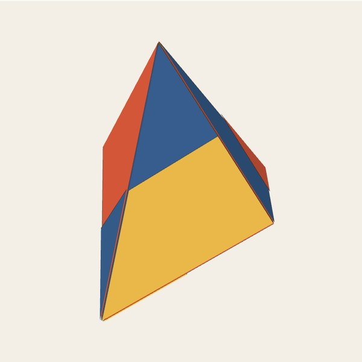
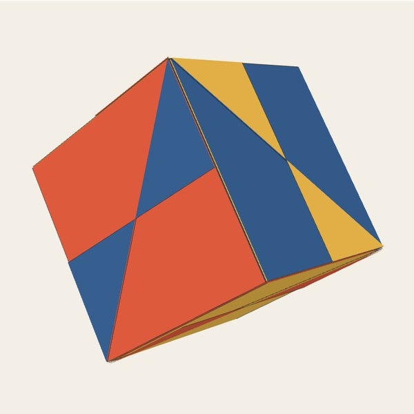
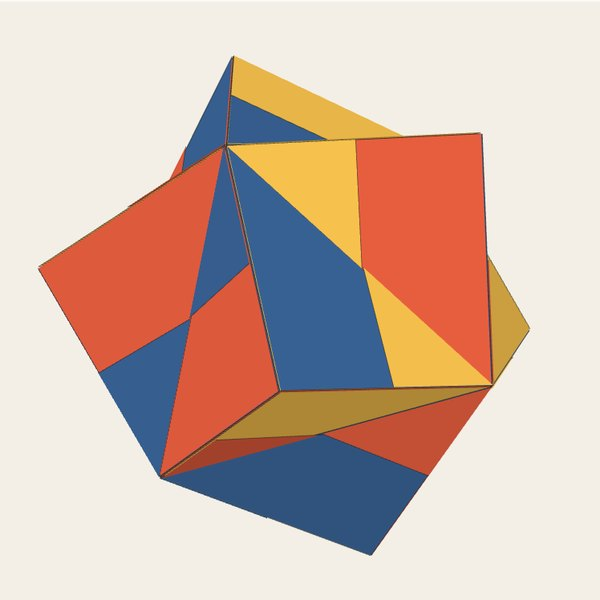
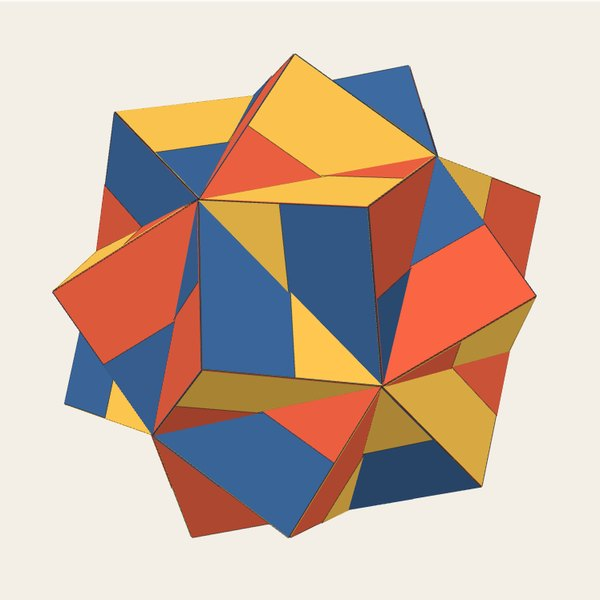

::: {.pageinfo}
Uses counting and one short calculation. About 6 minutes, most of it spent with one 3D figure. Written in collaboration with Claude.
:::

::: {.result}
**Question.** The same folded paper unit builds a closed shape from 3 copies, from 6, from 12 and from 30. How do the units hold together, and why those numbers?

**Answer.** Three units always lock into one small pyramid, and every unit is shared by two pyramids. So each unit is an edge of a hidden polyhedron with triangular faces. If the same number of triangles meets at every corner, that polyhedron can only have 3, 6, 12 or 30 edges.
:::

```{=html}
<figure class="kusu-figure">
<div class="kusu-heroes">
<figure><figcaption>3 units</figcaption></figure>
<figure><figcaption>6 units</figcaption></figure>
<figure><figcaption>12 units</figcaption></figure>
<figure><figcaption>30 units</figcaption></figure>
</div>
<figcaption>The four shapes, drawn by the figure below from its own model of the unit.</figcaption>
</figure>
```

Tomoko Fuse's kusudama are paper balls put together from many copies of one folded unit, with no glue, most of them from 12 or 30 units.^[[The Leading Expert in Unit Origami](https://gov-online.go.jp/eng/publicity/book/hlj/html/202112/202112_03_en.html), Government of Japan public relations site, December 2021, a profile of Fuse Tomoko: the units are assembled into one form "without using glue", and most works use 12 or 30 units.] A simple unit of this kind is the Sonobe unit, designed by Mitsunobu Sonobe and first published in 1968.^[David Mitchell, [The Sonobe Module](https://www.origamiheaven.com/historyofthesonobemodule.htm), The Public Paperfolding History Project: concludes that Sonobe designed the module, first published in 1968 in the second magazine of the Sosaku Origami Group '67, and that the three-unit "Jewel" is Toshie Takahama's.] Fuse designed many variations of it.^[Meenakshi Mukerji, [Sonobe variations](https://origamee.net/creation/sonobes.html), origamee.net: says that Fuse created many Sonobe variations, some of them in her book *Unit Origami*; lists a hexahedron from 3 units, a cube from 6, a stellated octahedron from 12 and a stellated icosahedron from 30.] With this unit the usual closed shapes take 3, 6, 12 and 30 copies. This page builds all four in 3D and then explains the numbers.

## The unit {#unit}

A finished unit is a flat parallelogram with two **flaps** and two **pockets**.^[[The History of Modular Origami](https://origami.maint.lovetoknow.com/The_History_of_Modular_Origami), LoveToKnow: "a parallelogram with two tabs and two 'pockets'". This page says flap where that one says tab.] The middle of the parallelogram is a square. A flap is a triangle on one side of the square. A pocket is a slit in the square: the tip of a neighbour's flap slides in under it.

```{=html}
<figure class="kusu-figure">
<svg class="kusu-unit" viewBox="0 0 400 200" role="img" aria-label="The flat unit: a parallelogram made of a square with a triangular flap on its left and right sides. A dashed line crosses the square from corner to corner. Two small triangles inside the square mark the pockets.">
  <polygon points="145,150 40,45 145,45" fill="#7f9cc4" stroke="#1d1d1d" stroke-width="1.2"/>
  <polygon points="355,150 250,150 250,45" fill="#7f9cc4" stroke="#1d1d1d" stroke-width="1.2"/>
  <polygon points="145,150 250,150 250,45 145,45" fill="#355c8c" stroke="#1d1d1d" stroke-width="1.2"/>
  <polygon points="250,97.5 197.5,97.5 250,45" fill="#25426a"/>
  <polygon points="145,97.5 197.5,97.5 145,150" fill="#25426a"/>
  <line x1="145" y1="97.5" x2="250" y2="97.5" stroke="#f3efe6" stroke-width="1.6"/>
  <line x1="250" y1="45" x2="145" y2="150" stroke="#f3efe6" stroke-width="1.4" stroke-dasharray="5 4"/>
  <line x1="145" y1="45" x2="145" y2="150" stroke="#f3efe6" stroke-width="1.4" stroke-dasharray="5 4"/>
  <line x1="250" y1="45" x2="250" y2="150" stroke="#f3efe6" stroke-width="1.4" stroke-dasharray="5 4"/>
  <text x="108" y="76" text-anchor="middle">flap</text>
  <text x="287" y="128" text-anchor="middle">flap</text>
  <line x1="303" y1="30" x2="237" y2="80" stroke="#222" stroke-width="1"/>
  <text x="307" y="26" text-anchor="start">pocket</text>
  <line x1="87" y1="170" x2="157" y2="116" stroke="#222" stroke-width="1"/>
  <text x="83" y="176" text-anchor="end">pocket</text>
  <line x1="200" y1="180" x2="183" y2="117" stroke="#222" stroke-width="1"/>
  <text x="200" y="194" text-anchor="middle">centre crease</text>
</svg>
<figcaption><b>What you're looking at:</b> the unit lying flat. Dashed lines are creases. The solid line across the square is the slit; the two dark triangles are the pocket lids that a neighbour's flap tip goes under. This is my own simplified drawing of a Sonobe-style unit, seen from the side that ends up outside; a real unit has more layers.</figcaption>
</figure>
```

The unit has three creases. Each flap folds back along the side of the square it hangs from, to a right angle. The third crease, the **centre crease**, runs across the square from corner to corner and splits it into two halves. How sharply it is folded is the only thing that differs between the four shapes.

## The one joint {#joint}

Take three units. Lay the flap of the first into a pocket of the second, the flap of the second into a pocket of the third, and the flap of the third into a pocket of the first. One half-square of each unit is now held in a ring of three. The three halves meet at a point where three right angles come together, like the corner of a box. They form a small three-sided **pyramid**.

Every shape on this page is made of that joint and nothing else. Each unit has two halves and two flaps, so it takes part in two pyramids, one on each side of its centre crease.

## Build them {#build}

```{=html}
<p class="looking"><b>What you're looking at:</b> paper units in three colours, drawn without thickness. Choose a number of units, then press Assemble or drag the slider. A flap stands up until the unit that carries its pocket has arrived, and then folds down into it. Drag the picture to turn it. Tap a unit to see it on its own.</p>
<div class="kusu-fig" data-start="3"></div>
<script src="three.min.js"></script>
<script src="kusudama.js"></script>
```

Three things to try:

- In any of the four, drag the slider slowly from 0 to 3. The first three units close the first pyramid. This is the joint from the previous section.
- Tap one unit in a finished shape. One half of its square is in one pyramid and the other half is in the next, and each flap lies on one more face.
- Tick "Show the hidden polyhedron". A dark edge appears under every centre crease.

The three colours are placed so that every pyramid has one unit of each colour. That is possible in all four shapes.

## The hidden polyhedron {#hidden}

A **polyhedron** is a closed shape made of flat faces that meet along edges and at corners. Flatten every pyramid down to its triangular base. What is left is a polyhedron with triangular faces, and it has

- one **face** for every pyramid,
- one **edge** for every unit, because a unit joins exactly two pyramids, and
- **corners** where the ends of the centre creases meet.

So the number of units is the number of edges of the hidden polyhedron. In the four shapes the hidden polyhedron is, in turn, a triangle counted as two faces back to back, a tetrahedron (4 triangles), an octahedron (8) and an icosahedron (20).

## Why 3, 6, 12 and 30 {#count}

Call the numbers of corners, edges and faces of the hidden polyhedron $V$, $E$ and $F$. Suppose the same number $q$ of triangles meets at every corner.

- Every face has 3 edges and every edge lies on 2 faces, so $3F = 2E$.
- Every corner has $q$ edges and every edge has 2 ends, so $qV = 2E$.
- Euler's formula says that $V - E + F = 2$ for any pattern of corners, edges and faces that covers a ball-shaped surface.^[Philip Rideout, [Euler's Polyhedron Formula](https://prideout.net/euler/): states the formula for "any convex polyhedron (or planar graph)" and walks through Legendre's proof. The triangle with two faces is the planar-graph case: 3 − 3 + 2 = 2.]

Put the first two into the third:

$$
\frac{2E}{q} - E + \frac{2E}{3} = 2,
\quad\text{so}\quad
E = \frac{6q}{6-q}.
$$

For $q$ equal to 2, 3, 4 and 5 this gives 3, 6, 12 and 30 edges. For $q = 1$ it gives $6/5$, which is not a whole number. For $q = 6$ the denominator is zero: six triangles around a corner lie flat, since $6 \times 60° = 360°$, and the pattern covers a plane without ever closing up. For $q \ge 7$ the result is negative. So the list stops at four.

- **3 units.** Hidden polyhedron: a triangle with two faces, $q = 2$. Finished shape: a triangular bipyramid, two pyramids base to base. Centre crease: a mountain fold, 109.5°.
- **6 units.** Hidden polyhedron: a tetrahedron, $q = 3$. Finished shape: a cube. Centre crease: left flat, 180°.
- **12 units.** Hidden polyhedron: an octahedron, $q = 4$. Finished shape: an octahedron with a pyramid on each face, called spiked in the figure. Centre crease: a valley fold, 141.1°.
- **30 units.** Hidden polyhedron: an icosahedron, $q = 5$. Finished shape: an icosahedron with a pyramid on each face. Centre crease: a valley fold, 112.3°.

A **mountain fold** is a ridge when you look at the outside of the shape; a **valley fold** is a groove. The angle given is the angle between the two halves of the square, and the figure computes it from its model. Folders usually call the last two shapes the stellated octahedron and the stellated icosahedron, and the first is known as Toshie's Jewel.^[Names as in Mukerji's list and Mitchell's history, both cited above.]

The count says what must hold if every corner looks the same. It does not say that nothing else can be built: without that condition the same unit makes other closed shapes, for instance from 90 units.^[Mukerji, same page: a cube from 12 units and a stellated dodecahedron from 90.]

::: {.callout-note collapse="true" appearance="minimal" title="Details: where the crease angles come from"}
Take the side of the square as 1. A pyramid's side faces are right isosceles triangles with legs 1, so its base is an equilateral triangle with side $\sqrt2$ and its height is $1/\sqrt3$. A side face makes the angle $\beta$ with the base, where $\tan\beta = \sqrt2$, so $\beta \approx 54.74°$.

Two pyramids share a unit along an edge of the hidden polyhedron. Let $\delta$ be the angle between the two faces of the hidden polyhedron at that edge, measured inside it. The two halves of the unit's square then meet at the angle $\delta + 2\beta$, measured through the inside of the shape.

- Triangle with two faces: $\delta = 0°$, so $2\beta \approx 109.47°$. Less than 180°: a ridge.
- Tetrahedron: $\cos\delta = 1/3$, and $\cos 2\beta = (1 - \tan^2\beta)/(1 + \tan^2\beta) = -1/3$, so $\delta + 2\beta = 180°$ exactly. The halves are level, and two of them make one face of the cube.
- Octahedron: $\delta \approx 109.47°$, total $\approx 218.94°$. More than 180°: a groove, and the angle on the outside is $360° - 218.94° \approx 141.06°$.
- Icosahedron: $\delta \approx 138.19°$, total $\approx 247.66°$, outside angle $\approx 112.34°$.

These are the numbers the figure shows; it gets them from the coordinates of the corners.
:::

::: {.callout-note collapse="true" appearance="minimal" title="Details: what the figure simplifies"}
- **The unit.** The drawing keeps the square, the two flaps and the two pockets and leaves out the other layers of a real folded unit. A pocket lid is drawn as the triangle that covers the tip of the flap.
- **Thickness.** The paper has none. Layers that lie on each other are drawn a hair apart.
- **Motion.** Real paper bends while you put a model together. Here every unit stays rigid. The first unit is creased where it lies; every later unit arrives already creased and travels straight in. Flaps that are still waiting lean back a little to let the next unit pass. At the last moment a flap's tip passes through the pocket lid instead of sliding under it.
- **Order.** The units go in pyramid by pyramid. Many other orders work.
:::

::: {.result}
**Takeaway.** One joint, three units around a pyramid tip, builds everything; one count, a unit for every edge and ${E = 6q/(6-q)}$, gives 3, 6, 12 and 30.
:::
