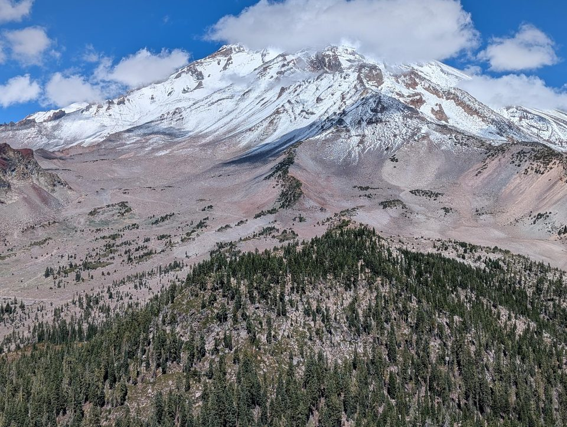
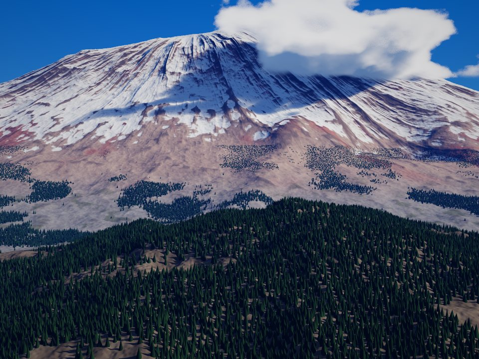
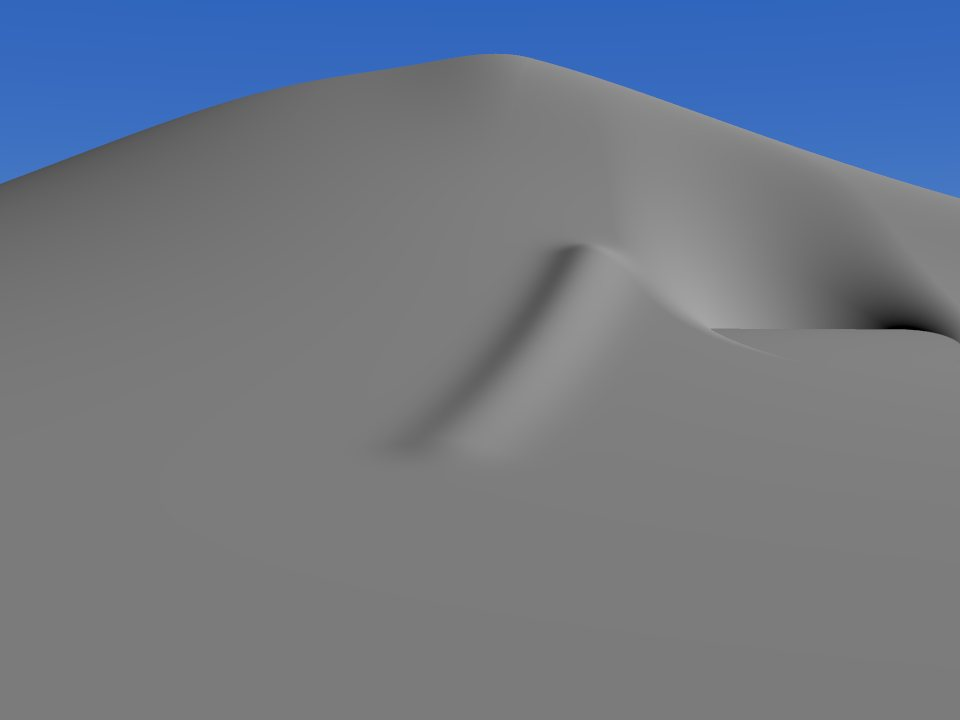
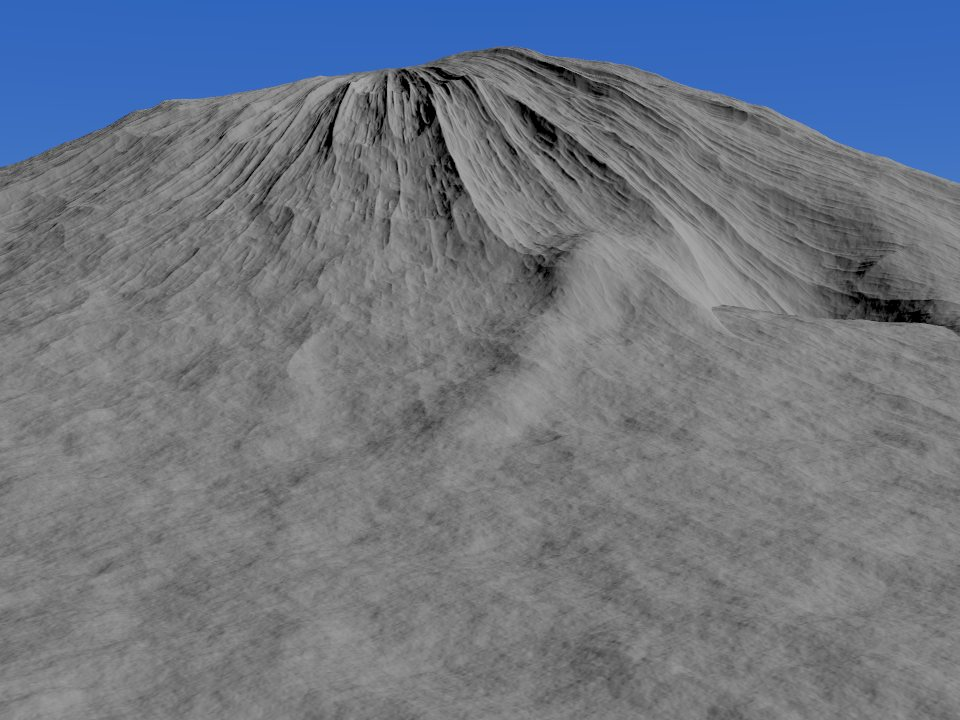
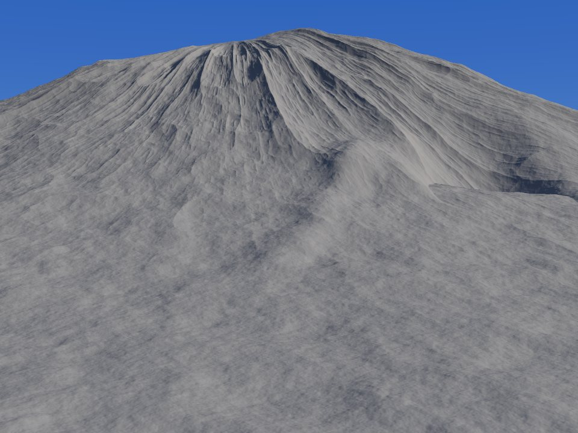
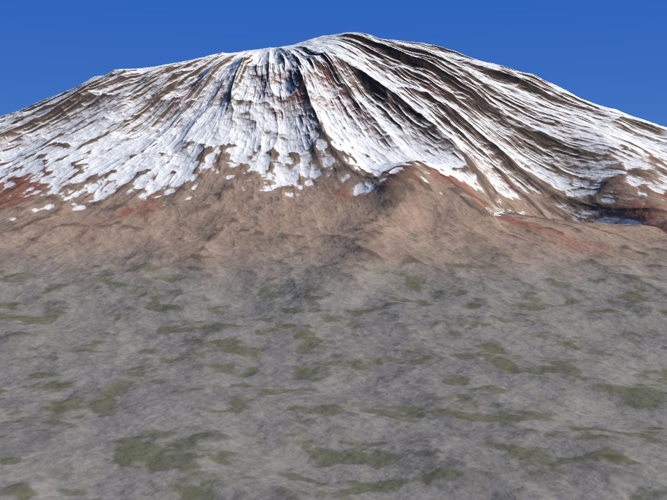
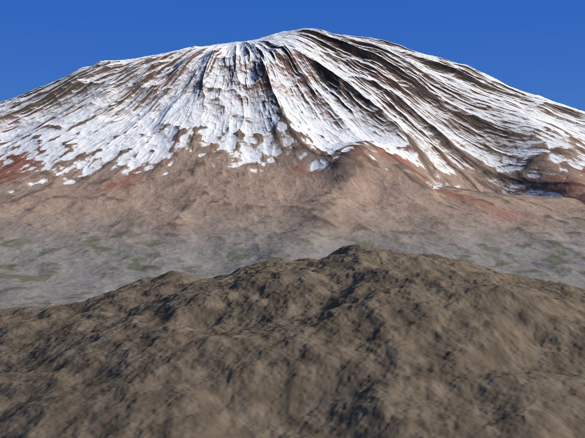
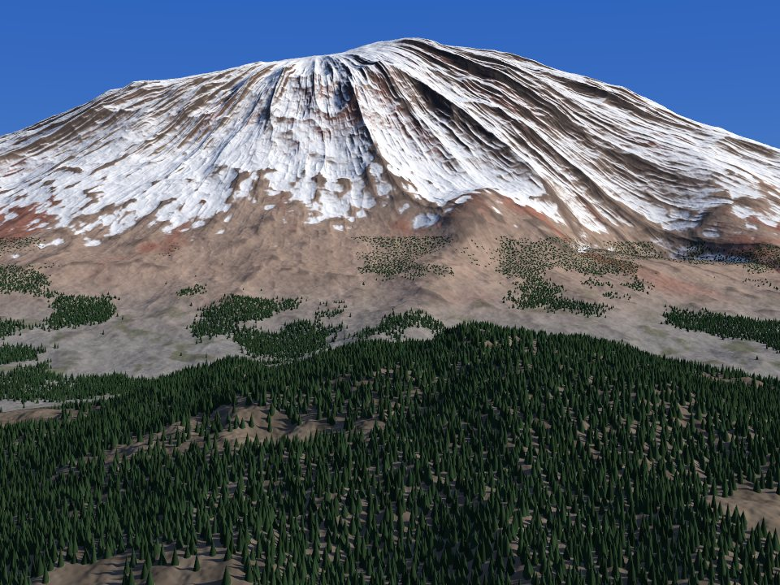
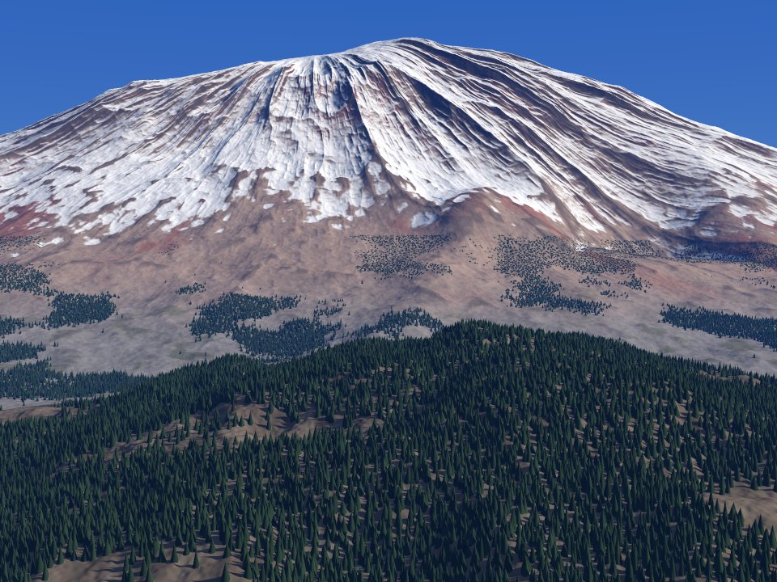
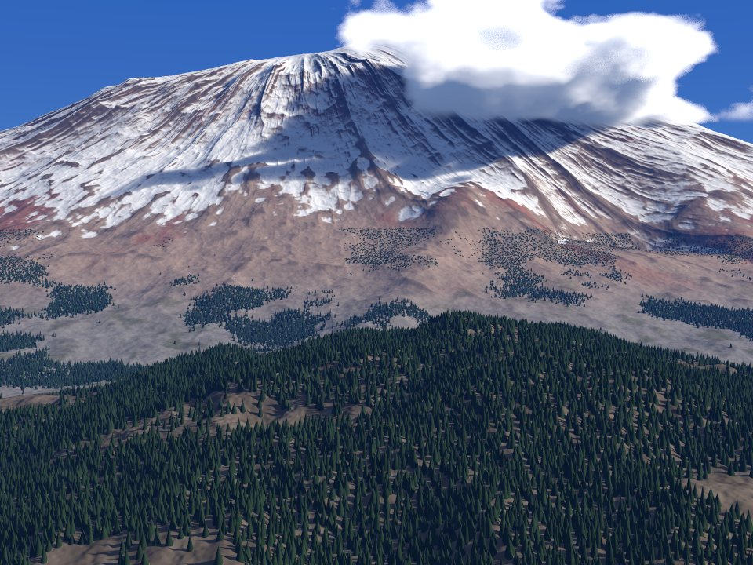

::: {.pageinfo}
Uses calculus and vectors; proofs are in folds. About 40 minutes to read, or 5 to look through the ten pictures. Written in collaboration with Claude, Anthropic's AI model.
:::

The second picture below is not a photograph. A program of about 450 lines draws it: for every pixel it follows the ray from the camera through that pixel into a landscape made of formulas, finds what the ray hits, and works out how much light comes back. The first is my photo of Mount Shasta, which it imitates.


```{=html}
<div class="vs-pair">
<figure><figcaption>My photo of Mount Shasta</figcaption></figure>
<figure><figcaption>Step 10, rendered by the shader</figcaption></figure>
</div>
<nav class="vs-strip" id="vs-strip" aria-label="The ten steps"></nav>
```


**Seen from kilometres away, a mountain is the graph of a height function, and every pixel can find where its ray meets that graph by taking steps that provably never jump through it, given a bound on how steep the graph can be.** Everything else in the picture is one more small function added to that same per-pixel computation: erosion, sunlight, rock and snow, a forest, haze, clouds. The ten steps below add them one at a time. Each step shows what it adds, on screen and in the code; the buttons above each image switch between that step, the previous step and a map of the pixels that changed, and "Render live" runs the step's shader on your own device.

## Why a shader and not a mesh {#tool}

Graphics tools such as [three.js](https://threejs.org/), [p5.js](https://p5js.org/) and [Shadertoy](https://www.shadertoy.com/) look like rivals, but the first choice is one level down: how the mountain is stored.

- **As a mesh**, a surface made of many small triangles. The graphics processor (GPU) projects every triangle onto the screen and colours the pixels it covers. The cost grows with the number of triangles plus the number of pixels. This is how three.js and game engines work.
- **As a height function $h(x,z)$**, the height of the ground above each point $(x,z)$ of a map (here $y$ is the height, so map points are $(x,z)$). For every pixel, a [fragment shader](https://www.khronos.org/opengl/wiki/Fragment_Shader), a small program the GPU runs once per pixel, walks along that pixel's ray until it meets the surface $y = h(x,z)$. This is called [ray marching](https://en.wikipedia.org/wiki/Ray_marching), and it is the Shadertoy style. The cost grows with pixels × steps × the cost of one evaluation of $h$.

For one fixed view of natural terrain between 1 and 10 km away, the height function has three advantages. First, precision adapts to distance by itself: the march stops once it is within about half a pixel of the ground, which means a few metres at 8 km and under half a metre at 1 km, while a mesh needs a [level-of-detail](https://en.wikipedia.org/wiki/Level_of_detail_(computer_graphics)) scheme to keep its triangles near pixel size at both distances. (The function itself is still evaluated in full detail everywhere, so detail finer than a pixel turns into speckle, which flickers when the camera moves, unless several rays per pixel are averaged; step 7 does that.) Second, one idea covers the whole picture: soft shadows and clouds are more walks along rays, and the haze is an integral along the same ray that happens to have a closed form. Third, the whole scene is about 450 lines of GLSL, the GPU's programming language, with no dependencies. Meshes win elsewhere: a camera that moves smoothly, scenes you can walk through, geometry you can edit, and trees seen up close.

::: {.callout-note collapse="true" appearance="minimal" title="For graphics programmers: the comparison in detail"}
::: {.table-scroll}
| | Ray-marched fragment shader | three.js (triangle meshes) | p5.js (2D canvas) | Offline renderer (e.g. Blender) |
|---|---|---|---|---|
| The mountain is | a function $h(x,z)$, evaluated per pixel | a grid of triangles, raised by $h$ | 2D shapes | a mesh, traced with physically based light |
| Near and far detail | automatic: stop within a pixel | needs a level-of-detail scheme | not applicable | brute force: a very dense mesh |
| Sky light | a formula per pixel | the same formula, built in (`HemisphereLight`) | none built in | physically correct |
| Soft shadows | one extra march toward the sun | [shadow maps](https://en.wikipedia.org/wiki/Shadow_mapping), several for a 10 km scene | none built in | physically correct, minutes per frame |
| Haze, volumetric clouds | the same marching code | a custom ray-marching shader anyway | impractical | excellent, slow |
| Forest | cones in the height function; fine beyond about 100 m | [instanced](https://en.wikipedia.org/wiki/Geometry_instancing) tree meshes; best up close | flat sprites | instanced geometry |
| Moving camera | stills in seconds; 60 frames per second only at low resolution | 60 frames per second out of the box | easy in 2D | no |
:::

p5.js also has a WEBGL mode, which can run exactly the shader used here; the column describes its default 2D canvas.
:::

So the mountain here is a ray-marched fragment shader, run by a few lines of plain [WebGL2](https://developer.mozilla.org/en-US/docs/Web/API/WebGL2RenderingContext), the browser's interface to the GPU. Shadertoy makes a good sketchbook, and every step below exports to it with one click, but a single shader in Shadertoy's Image tab redraws the whole picture every frame, which wastes work on a still image. The same $h(x,z)$ can later raise a three.js mesh if the scene needs to be explored rather than looked at.

## The setup {#setup}

Units are kilometres, and $y$ points up. The camera stands 0.70 km above the base plane $y = 0$ at the origin, looks toward $-z$, and has a 30° vertical field of view (39° across the 4 : 3 frame, about what a standard 50 mm lens sees across a full-frame photo), chosen to match the photo's framing. The base plane stands for roughly 2 km above sea level; that number matters only for the air density in step 8.

The shader is assembled from named pieces of GLSL, which we call chunks, glued together in order. Each step adds chunks or replaces earlier ones, and the code under each step is exactly the set of chunks that changed. A few functions connect them: `terrain(x)` returns the ground height at the map point `x`; `sceneStep(p)` returns a step length that cannot jump through the surface, together with the vertical gap to it; `groundAlbedo(p, n)` says what the ground is made of; `shade`, `atmosphere`, `marchClouds` and `post` turn that into light and then into pixel values. Each image in this post was rendered from exactly the code shown under it.

The host is a short JavaScript class that compiles the shader and draws one triangle covering the screen. It draws in horizontal strips of about 35 ms each, because operating systems reset a GPU that stays busy too long (after two seconds by default on Windows^[Microsoft, [Timeout detection and recovery (TDR)](https://learn.microsoft.com/en-us/windows-hardware/drivers/display/timeout-detection-and-recovery): "The default timeout period in Windows is two seconds."]), and the browser then loses its connection to the GPU (its WebGL context) and stops drawing.

::: {.callout-note collapse="true" appearance="minimal" title="The WebGL2 host (renderer.js, complete)"}

```javascript
// Minimal WebGL2 host for full-screen fragment shaders.
// One shared GL context renders any shader in horizontal tiles (so a heavy shader never
// blocks the GPU long enough to trip a watchdog), then copies the result to a 2D canvas.
class ShaderRenderer {
  constructor() {
    this.canvas = document.createElement('canvas');
    const gl = this.canvas.getContext('webgl2', { preserveDrawingBuffer: true, antialias: false, alpha: false });
    if (!gl) throw new Error('WebGL2 is not available in this browser.');
    this.gl = gl;
    this.programs = new Map();
    this.vs = this._compile(gl.VERTEX_SHADER,
      '#version 300 es\n' +
      'void main() {\n' +
      '  // one triangle that covers the whole screen: (-1,-1), (3,-1), (-1,3)\n' +
      '  vec2 p = vec2((gl_VertexID << 1) & 2, gl_VertexID & 2);\n' +
      '  gl_Position = vec4(2.0 * p - 1.0, 0.0, 1.0);\n' +
      '}\n');
    this.busy = Promise.resolve();
  }

  _compile(type, src) {
    const gl = this.gl, s = gl.createShader(type);
    gl.shaderSource(s, src);
    gl.compileShader(s);
    if (!gl.getShaderParameter(s, gl.COMPILE_STATUS)) {
      const log = gl.getShaderInfoLog(s);
      gl.deleteShader(s);
      throw new Error('Shader compile error:\n' + log);
    }
    return s;
  }

  program(fsSource) {
    if (this.programs.has(fsSource)) return this.programs.get(fsSource);
    const gl = this.gl, p = gl.createProgram();
    gl.attachShader(p, this.vs);
    gl.attachShader(p, this._compile(gl.FRAGMENT_SHADER, fsSource));
    gl.linkProgram(p);
    if (!gl.getProgramParameter(p, gl.LINK_STATUS)) throw new Error('Link error:\n' + gl.getProgramInfoLog(p));
    this.programs.set(fsSource, p);
    return p;
  }

  // Queue renders so only one uses the shared context at a time.
  render(fsSource, target, opts) {
    const job = this.busy.then(() => this._render(fsSource, target, opts));
    this.busy = job.catch(() => {});
    return job;
  }

  async _render(fsSource, target, { width, height, spp = 1, uniforms = {}, onProgress, msPerTile = 35 }) {
    const gl = this.gl;
    this.canvas.width = width; this.canvas.height = height;
    target.width = width; target.height = height;
    const ctx = target.getContext('2d');
    const prog = this.program(fsSource);
    gl.useProgram(prog);
    gl.viewport(0, 0, width, height);
    const loc = n => gl.getUniformLocation(prog, n);
    gl.uniform2f(loc('uRes'), width, height);
    gl.uniform1i(loc('uSpp'), spp);
    for (const [k, v] of Object.entries(uniforms)) {
      const l = loc(k); if (!l) continue;
      if (Array.isArray(v)) gl['uniform' + v.length + 'fv'](l, v); else gl.uniform1f(l, v);
    }
    gl.enable(gl.SCISSOR_TEST);
    const px = new Uint8Array(4);
    let y = 0, rows = 4;
    const start = performance.now();
    while (y < height) {
      const h = Math.min(rows, height - y);
      const y0 = height - y - h;                 // GL's origin is bottom-left; we render top-down
      gl.scissor(0, y0, width, h);
      const t0 = performance.now();
      gl.drawArrays(gl.TRIANGLES, 0, 3);
      gl.readPixels(0, y0, 1, 1, gl.RGBA, gl.UNSIGNED_BYTE, px);   // wait for the tile to finish
      const dt = performance.now() - t0;
      y += h;
      rows = Math.max(1, Math.min(256, Math.round(rows * msPerTile / Math.max(dt, 1))));
      ctx.drawImage(this.canvas, 0, 0);
      if (onProgress) onProgress(y / height);
      await new Promise(r => setTimeout(r, 0));
    }
    gl.disable(gl.SCISSOR_TEST);
    return performance.now() - start;
  }
}
```

:::

## Step 1 · A ray for every pixel {#step-1}

A fragment shader is a function from a pixel to a colour. Ours builds the ray through each pixel and, for now, returns the colour of the sky.

::: {.added data-step="1"}
[Added in this step]{.vs-label}

On screen
:   Only sky: deep blue at the top of the frame, paler toward the horizon.

In the code
:   []{.chg}
:::


```{=html}
<figure class="render" data-step="1">

<div class="frame"><span class="tag">Step 1</span><div class="bar"></div></div>

<figcaption><span class="what status">Pre-rendered from the code below · 960 × 720 · 2 × 2 rays per pixel</span>
<span class="ctl"><select id="spp-1" aria-label="Rays per pixel for the live render"><option value="1" selected>1 ray</option><option value="2">2 × 2</option><option value="3">3 × 3</option></select><button type="button" class="go primary">Render live</button><button type="button" class="back" hidden>Show pre-rendered</button></span></figcaption>
</figure>
```


The GPU runs `main()` once per pixel, for all pixels in parallel. Every later step answers the same question for each pixel: what does the ray through this pixel see? With an empty world, the answer is the sky, even for rays that point below the horizon; that is why the lower half of the step-1 image is a flat, pale blue.

### The camera

From the eye $E$, a target point $T$ and the vertical field of view $\theta$, build three perpendicular unit vectors, forward $f$, right $r$ and up $u$:

$$
\begin{gathered}
f = \frac{T-E}{\lVert T-E\rVert},\qquad r = \frac{f\times\hat y}{\lVert f\times\hat y\rVert},\\
u = r\times f,
\end{gathered}
$$

where $\hat y$ is the unit vector pointing straight up. A point $(i, j)$ of a $W\times H$ image, measured in pixels from its bottom-left corner (pixel centres sit at half-integers), maps to the screen point $s = \big(2\,(i,j) - (W,H)\big)/H$, so $s_y$ runs from $-1$ at the bottom edge to $1$ at the top. The ray through that pixel starts at $E$ and has direction

$$
\begin{gathered}
d = \frac{v}{\lVert v\rVert},\\
v = f + \tan(\theta/2)\,(s_x\,r + s_y\,u),
\end{gathered}
$$

so its points are $P(t) = E + t\,d$ for $t\ge 0$. At the top edge $s_y = 1$, and the ray leans exactly $\theta/2$ above the forward direction, as it should.

### The sky

A ray at elevation angle $\alpha$ above the horizon crosses a flat layer of air along a path $m = 1/\sin \alpha$ times longer than straight up; astronomers call $m$ the air mass. On the real, curved Earth the air mass tops out near 38 at the horizon,^[Wikipedia, [Air mass (astronomy)](https://en.wikipedia.org/wiki/Air_mass_(astronomy)): the plane-parallel air mass is the secant of the zenith angle, and the air mass at the horizon is about 38.] and the shader caps $m$ at 33 by treating every ray as at least $\sin\alpha = 0.03$ above the horizon. Longer paths scatter more light of every colour, which is why the sky whitens toward the horizon. The shader blends a zenith blue into a paler horizon blue with weight $w = 1 - e^{-\beta(m-1)}$ ($\beta = 0.08$), which is 0 straight up and about 0.92 at the horizon, and adds a faint glow around the sun.

### Linear light

All lighting is computed in linear units, proportional to the amount of light, and only the last line converts to [sRGB](https://en.wikipedia.org/wiki/SRGB), the encoding screens expect. Doing arithmetic on encoded values is a classic error: the sRGB value 0.5 emits $\big((0.5+0.055)/1.055\big)^{2.4}\approx 0.21$ of white's light, not half.^[Wikipedia, [sRGB](https://en.wikipedia.org/wiki/SRGB): the transfer function, linear below 0.04045 and $((C+0.055)/1.055)^{2.4}$ above.] The `main()` below also averages several rays per pixel, which matters from step 7 on.


```{=html}
<div class="vcode" data-step="1"></div>
<details class="full" data-step="1"><summary>Full shader for step 1</summary><div class="inner"></div></details>
```


::: {.cut}
[Shortcut taken]{.vs-label} Each step ends with a box like this: what the step simplifies, when that is safe, and when it is not.

Cut
:   No scattering physics in the sky: one blend parameter and two colours.

Safe
:   As a backdrop above mountains; the photo shows sky only well above the horizon.

Unsafe
:   Sunsets, open horizons, or any scene where the sky must agree with the light on the ground. Those need a physically based sky model, such as [Hillaire's](https://diglib7.eg.org/bitstream/handle/10.1111/cgf14050/v39i4pp013-022.pdf).
:::

## Step 2 · The first mountain {#step-2}

A mountain without overhangs is the graph of a function. We shape one, then find where each ray first meets it.

::: {.added data-step="2"}
[Added in this step]{.vs-label}

On screen
:   A smooth grey volcano with a shoulder on the right, a spur in the middle, and a flat ledge on the right where a bowl is cut into the flank. The sun is the only light, so faces turned away from it are black.

In the code
:   []{.chg}
:::


```{=html}
<figure class="render" data-step="2">
<div class="views" role="group" aria-label="Image to show"><button type="button" data-view="cur">Step 2</button><button type="button" data-view="prev">Step 1</button><button type="button" data-view="diff">What changed</button></div>
<div class="frame"><span class="tag">Step 2</span><div class="bar"></div></div>
<p class="diffnote" hidden></p>
<figcaption><span class="what status">Pre-rendered from the code below · 960 × 720 · 2 × 2 rays per pixel</span>
<span class="ctl"><select id="spp-2" aria-label="Rays per pixel for the live render"><option value="1" selected>1 ray</option><option value="2">2 × 2</option><option value="3">3 × 3</option></select><button type="button" class="go primary">Render live</button><button type="button" class="back" hidden>Show pre-rendered</button></span></figcaption>
</figure>
```


### The shape

Mount Shasta is a [stratovolcano](https://en.wikipedia.org/wiki/Stratovolcano),^[Wikipedia, [Mount Shasta](https://en.wikipedia.org/wiki/Mount_Shasta): "a potentially active stratovolcano".] a cone built of layered lava and ash: steep near the top and flattening into a broad apron, so its profile curves upward. An exponential decay does this with a height $H_0$ and a decay length $\lambda$:

$$
\begin{gathered}
h_0(x,z) = H_0\exp\!\Big(-\sqrt{r^2+a^2}\,\big/\,\lambda\Big),\\
r = \Big\lVert\Big(\tfrac{x-x_0}{2},\; z-z_0\Big)\Big\rVert,
\end{gathered}
$$

where $(x_0, z_0)$ is the summit's map position, $H_0 = 3.67$ km and $\lambda = 1.64$ km. The $\sqrt{r^2+a^2}$ rounds off the point at the summit over a radius $a = 0.8$ km, and dividing $x - x_0$ by 2 stretches the cone sideways into the broad massif of the photo. The cone alone peaks at $H_0e^{-a/\lambda}\approx 2.25$ km above the base plane, about 4.25 km above sea level, close to Shasta's 4,322 m.^[Wikipedia, [Mount Shasta](https://en.wikipedia.org/wiki/Mount_Shasta): elevation 14,179 ft (4,322 m).] Three hand-placed landforms follow: a shoulder ridge to the right, a spur running toward the camera, and a flat-floored [cirque](https://en.wikipedia.org/wiki/Cirque) (a bowl carved by a glacier) cut into the right flank, which we see almost edge-on, blended in with a smooth minimum, the minimum of two heights with its corner rounded off.^[I. Quilez, [Smooth minimum](https://iquilezles.org/articles/smin/): the quadratic polynomial smooth minimum used here.] These three are composition, placed by comparing renders with the photo; nothing about them is simulated.


```{=html}
<figure class="diagram"><svg id="vs-profile" role="img" aria-label="Profile of the base cone along the view axis, drawn to scale, with the camera and the edges of its field of view."></svg>
<figcaption>The base cone h₀ cut through the summit, drawn to scale, with the local slope angle at four points. The dashed lines are the top and bottom edges of the 30° field of view. The camera stands 0.5 km to the side of this cut, so its position here is approximate.</figcaption></figure>
```


### Where does the ray hit?

The ray meets the ground at the smallest $t>0$ for which the point $P(t)$ lies on the surface, $P_y = h(P_x, P_z)$. Write $g(p) = p_y - h(p_x,p_z)$ for the vertical gap between a point $p$ and the ground below it, positive above the ground. Stepping forward by the whole gap can jump through a steep slope; the safe step is smaller by a factor that depends only on how steep the terrain can be. "How steep" is measured by a [Lipschitz constant](https://en.wikipedia.org/wiki/Lipschitz_continuity): $h$ is $L$-Lipschitz if $|h(u)-h(v)|\le L\,\lVert u-v\rVert$ for all map points $u, v$, which says no slope anywhere is steeper than $L$.

::: {.claim}
**Claim (safe step).** Let $h$ be $L$-Lipschitz and $g(p)>0$. Then every point $q$ on or below the surface satisfies $\lVert p-q\rVert \ge g(p)/\sqrt{1+L^2}$.
:::

::: {.callout-note collapse="true" appearance="minimal" title="Proof"}
Write $s = \lVert q_{xz} - p_{xz}\rVert$ for the horizontal distance and $g = g(p)$. Because $q$ is on or below the surface and $h$ is $L$-Lipschitz, $q_y \le h(q_{xz}) \le h(p_{xz}) + Ls = p_y - g + Ls$, so $p_y - q_y \ge g - Ls$. If $s\ge g/L$, then $\lVert p-q\rVert \ge s \ge g/L \ge g/\sqrt{1+L^2}$. Otherwise $g - Ls > 0$, and by Pythagoras $\lVert p-q\rVert^2 \ge s^2 + (g-Ls)^2$. This quadratic in $s$ is smallest at $s^\ast = Lg/(1+L^2)$, where it equals $g^2/(1+L^2)$. $\blacksquare$
:::


```{=html}
<figure class="diagram"><svg viewBox="0 0 360 205" role="img" aria-label="A point p above the terrain, its vertical gap g to the ground, the cone of slope L below p that the terrain must stay under, and the largest ball around p that fits above the cone.">
<path class="fillg" d="M10,190 C50,182 90,160 125,152 C150,146 165,168 180,170 C195,172 215,140 240,132 C270,122 310,150 350,168 L350,205 L10,205 Z"/>
<path class="ink" stroke-width="1.6" d="M10,190 C50,182 90,160 125,152 C150,146 165,168 180,170 C195,172 215,140 240,132 C270,122 310,150 350,168"/>
<path class="scr" stroke-width="1.2" d="M60,50 L180,170 L300,50"/>
<circle class="acc" stroke-width="1.4" cx="180" cy="70" r="70.7"/>
<line class="ink" stroke-dasharray="3 3" x1="180" y1="70" x2="180" y2="170"/>
<circle class="dot" cx="180" cy="70" r="3.5"/><circle class="dot" cx="180" cy="170" r="2.5"/>
<text x="188" y="66">p</text><text x="186" y="124">g</text>
<text x="300" y="44" text-anchor="end">slope L</text>
<text x="252" y="104">safe ball</text>
<text x="8" y="104" style="font-size:10px">terrain stays</text><text x="8" y="117" style="font-size:10px">below the cone,</text><text x="8" y="130" style="font-size:10px">outside the ball</text>
</svg><figcaption>No slope is steeper than L, so the terrain stays below the cone of slope L drawn from the ground point under p (here L = 1). The largest ball around p that fits above that cone has radius g/√(1 + L²), so a step of that length cannot reach the ground.</figcaption></figure>
```


So the update $t \leftarrow t + g/\sqrt{1+L^2}$ never jumps through the ground, provided the terrain really is no steeper than $L$. This is Hart's sphere tracing^[J. C. Hart, [Sphere tracing: a geometric method for the antialiased ray tracing of implicit surfaces](https://link.springer.com/article/10.1007/s003710050084), *The Visual Computer* 12 (1996), 527–545: stepping by a lower bound on the distance to the surface.] specialized to height fields. Allowing slopes up to $L\approx 1.7$ (60°) gives the factor 0.5 in `sceneStep`.

The march moves by the safe step but stops on the gap itself, once $|g|$ is below $0.0004\,t$. One pixel spans $2\tan 15^\circ/720 \approx 7.4\times10^{-4}$ radians, so at distance $t$ that tolerance is about half a pixel. Detail smaller than a pixel cannot be seen, which is the same reason Quilez lets the marching error grow with distance.^[I. Quilez, [Terrain raymarching](https://iquilezles.org/articles/terrainmarching): the allowed error, and the step, grow linearly with the distance travelled.] If a step does land below ground, the gap turns negative and the next step walks back; step 6 shows where our terrain breaks the budget and what that costs.

### The normal

Shading needs the surface's normal, the unit vector perpendicular to it. Write $h_x$ and $h_z$ for the slopes of $h$ in the $x$ and $z$ directions (its partial derivatives). Walking one unit in $x$ along the surface moves you by $(1, h_x, 0)$, and one unit in $z$ by $(0, h_z, 1)$; the vector $(-h_x,\,1,\,-h_z)$ has zero dot product with both, so it is perpendicular to the surface, and dividing by its length gives the normal. The shader estimates each slope from two nearby heights, $h_x \approx \big(h(x+\varepsilon, z) - h(x-\varepsilon, z)\big)/2\varepsilon$, with $\varepsilon = 0.0005\,t + 0.0002$ km, about one pixel wide at distance $t$, so detail finer than a pixel does not leak into the shading.

### Light, for now

For now the sun is the only light. By [Lambert's cosine law](https://en.wikipedia.org/wiki/Lambert%27s_cosine_law), a face receives sunlight in proportion to $\max(0,\,n\cdot\ell)$, the cosine of the angle between its normal $n$ and the direction $\ell$ toward the sun. The sun here stands almost exactly to our right, slightly behind us, 30° above the horizon. Faces turned away from it get nothing and come out black. That is what an airless world looks like: shadows on the Moon are nearly black because it has no air to scatter sunlight into them.^[S. Braden, [Sunset Boulder](https://www.lroc.asu.edu/images/476), Lunar Reconnaissance Orbiter Camera, Arizona State University (2012): "The Moon has no atmosphere to scatter light, so a shadowed area on the Moon is as dark as night."] Step 4 adds our sky.


```{=html}
<div class="vcode" data-step="2"></div>
<details class="full" data-step="2"><summary>Full shader for step 2</summary><div class="inner"></div></details>
```


::: {.cut}
[Shortcut taken]{.vs-label}

Cut
:   A height field cannot overhang, arch or hollow out. The large forms are placed by hand. The Lipschitz constant is a budget chosen by hand, not checked, and from step 3 on the terrain breaks it in places (step 6).

Safe
:   Mountains seen from kilometres away, and any terrain whose cliffs never lean past vertical.

Unsafe
:   Close-up cliffs, arches, sea stacks. Keep the same loop but march a full 3D signed distance function (the distance to the nearest surface point, negative inside) instead of $y - h$.
:::

## Step 3 · Ridges and gullies {#step-3}

Real terrain has detail at every scale, with smaller features lower. Fractal noise supplies that, and lining it up with the downhill direction turns it into gullies.

::: {.added data-step="3"}
[Added in this step]{.vs-label}

On screen
:   Ribs and gullies running down from the summit, and fine lumps everywhere. The left side of each rib faces away from the sun and comes out dark.

In the code
:   []{.chg}
:::


```{=html}
<figure class="render" data-step="3">
<div class="views" role="group" aria-label="Image to show"><button type="button" data-view="cur">Step 3</button><button type="button" data-view="prev">Step 2</button><button type="button" data-view="diff">What changed</button></div>
<div class="frame"><span class="tag">Step 3</span><div class="bar"></div></div>
<p class="diffnote" hidden></p>
<figcaption><span class="what status">Pre-rendered from the code below · 960 × 720 · 2 × 2 rays per pixel</span>
<span class="ctl"><select id="spp-3" aria-label="Rays per pixel for the live render"><option value="1" selected>1 ray</option><option value="2">2 × 2</option><option value="3">3 × 3</option></select><button type="button" class="go primary">Render live</button><button type="button" class="back" hidden>Show pre-rendered</button></span></figcaption>
</figure>
```


### Value noise

Value noise puts a pseudo-random number at every point of an integer grid, computed from the point's coordinates by a hash function (a formula that turns coordinates into a random-looking but repeatable number),^[D. Hoskins, [Hash without Sine](https://www.shadertoy.com/view/4djSRW) (Shadertoy): the hash functions `hash12` and `hash22` used here.] and blends the four corner values $a, b, c, d$ of each grid cell. At position $(\xi, \eta)\in[0,1)^2$ inside the cell,

$$
n = \big(1-\varphi(\eta)\big)\Big[\big(1-\varphi(\xi)\big)a + \varphi(\xi)\,b\Big] + \varphi(\eta)\Big[\big(1-\varphi(\xi)\big)c + \varphi(\xi)\,d\Big],
$$

with the fade curve

$$
\begin{gathered}
\varphi(t) = 6t^5 - 15t^4 + 10t^3,\\
\varphi'(t) = 30t^2(t-1)^2,\qquad \varphi''(t) = 60t(2t-1)(t-1).
\end{gathered}
$$

Both derivatives vanish at $t = 0$ and $t = 1$, so the noise is twice continuously differentiable across cell borders. The older fade $3t^2 - 2t^3$ has a second derivative that jumps at the borders. The normal is built from the first derivative, so such a jump is a sudden change in how fast the shading changes, and the eye sees it as a crease. This quintic is Perlin's fix.^[K. Perlin, [Implementing Improved Perlin Noise](https://developer.nvidia.com/gpugems/gpugems/part-i-natural-effects/chapter-5-implementing-improved-perlin-noise), *GPU Gems*, ch. 5 (2004): replaces $3t^2-2t^3$ by $6t^5-15t^4+10t^3$ so the second derivative is continuous.]

### Fractal sums

A fractal sum adds copies of the noise, called octaves, each with double the frequency and half the amplitude of the one before. It imitates the statistics of [fractional Brownian motion](https://en.wikipedia.org/wiki/Fractional_Brownian_motion), a standard random model of rough terrain, and is usually called fBm:

$$
\begin{gathered}
\operatorname{fbm}(x) = \sum_{i=0}^{N-1} G^{\,i+1}\,\big(2\,n(M^i x) - 1\big),\\
G = \tfrac12,\qquad M = 2\begin{pmatrix}0.8 & 0.6\\ -0.6 & 0.8\end{pmatrix},
\end{gathered}
$$

where $n$ is the value noise, so each term lies in $[-G^{i+1}, G^{i+1}]$ and the sum stays within $[-1, 1]$. Halving the amplitude at each doubling of frequency corresponds to a Hurst exponent of 1 (the exponent that sets how fast detail shrinks with scale; fBm proper needs it below 1, so 1 is the limiting case), and Quilez reports that the skylines of real mountains he measured fit that value.^[I. Quilez, [fBm](https://iquilezles.org/articles/fbm/): G = 1/2 "corresponds to H=1", and from photographed skylines, "mountain profiles follow a -9dB/octave frequency distribution, which corresponds with B=-3 or H=1 or G=0.5"; he calls this "not a rigorous/scientific experiment".] The matrix $M$ also rotates each octave by $\arctan(3/4)\approx 36.9^\circ$, so the grids of different octaves do not line up into a visible pattern. *Ridged* noise replaces each octave $n$ by $(1 - |2n-1|)^2$: folding the noise at its midpoint turns every place where it crosses ½ into a sharp crest.

### Gullies run downhill

Water and debris flow straight downhill. On a round cone downhill points directly away from the summit; ours is stretched sideways, so on its flanks the true downhill direction is up to about 37° off the radial one, but radial lines are close enough for the eye. The shader therefore samples ridged noise in polar coordinates $(\psi, r)$ around the summit, with $r$ the stretched distance of step 2:

$$
h_{\text{gullies}}(x) = 0.34\,\rho(r)\,\operatorname{ridged}(3.5\,\psi,\ 0.7\,r),
$$

where the radial weight $\rho(r)$ (`fade` in the code) is 0 at the summit and dies away on the far apron. That is 3.5 grid cells per radian around the mountain and 0.7 cells per kilometre downhill: each cell is long in the downhill direction and narrow across it, so the crests come out as long radial ribs. These octaves are scaled without rotation, because a rotation would mix $\psi$ with $r$ and destroy the alignment. The angle is measured so that $\psi = 0$ points toward the camera, which hides the seam, where the angle jumps from $\pi$ to $-\pi$, behind the summit. A broad seven-octave fBm adds lumps of about 35 m everywhere.


```{=html}
<div class="vcode" data-step="3"></div>
<details class="full" data-step="3"><summary>Full shader for step 3</summary><div class="inner"></div></details>
```


::: {.cut}
[Shortcut taken]{.vs-label}

Cut
:   This is the look of erosion, not erosion. Real drainage branches and merges downhill and leaves fans of debris at the bottom; these ribs run side by side and only widen with distance. Value noise is also slightly blockier than gradient (Perlin) noise; the octave rotation hides most of it. And the ribs are steeper in places than the march's slope budget (step 6).

Safe
:   Oblique views from a distance, where the eye reads "ribs and gullies".

Unsafe
:   Map views and flyovers. Simulate hydraulic erosion once and store the result in a texture.
:::

## Step 4 · Sky light and shadows {#step-4}

Steps 2 and 3 had one light, the sun, shining straight through solid rock. Daylight adds the blue sky, which lights every face from above, and a little light bounced off the ground. And terrain blocks the sun, which makes shadows.

::: {.added data-step="4"}
[Added in this step]{.vs-label}

On screen
:   The dark faces turn blue-grey, because the sky now lights them, and sunlit faces brighten slightly and turn faintly bluer. Cast shadows are rare in this view; the text explains why.

In the code
:   []{.chg}
:::


```{=html}
<figure class="render" data-step="4">
<div class="views" role="group" aria-label="Image to show"><button type="button" data-view="cur">Step 4</button><button type="button" data-view="prev">Step 3</button><button type="button" data-view="diff">What changed</button></div>
<div class="frame"><span class="tag">Step 4</span><div class="bar"></div></div>
<p class="diffnote" hidden></p>
<figcaption><span class="what status">Pre-rendered from the code below · 960 × 720 · 2 × 2 rays per pixel</span>
<span class="ctl"><select id="spp-4" aria-label="Rays per pixel for the live render"><option value="1" selected>1 ray</option><option value="2">2 × 2</option><option value="3">3 × 3</option></select><button type="button" class="go primary">Render live</button><button type="button" class="back" hidden>Show pre-rendered</button></span></figcaption>
</figure>
```


The new function `shade()` sums three terms: sunlight (now slightly yellow, and multiplied by a shadow factor), sky light, and light bounced off the ground. The sky's blue outweighs the sun's slight yellow, so even sunlit faces end up faintly bluer. Switch between "Step 4" and "Step 3" above: the change sits in the faces that were dark, which now pick up blue-grey light from the sky. The same term is why snow in shade will look blue in step 5.

### How much sky does a slope see?

A flat patch of ground sees the whole sky; a vertical wall sees half of it. The amount of light arriving per unit area, the [irradiance](https://en.wikipedia.org/wiki/Irradiance), has an exact formula for a uniform sky, in terms of the sky's radiance $B$, its brightness per unit [solid angle](https://en.wikipedia.org/wiki/Solid_angle).

::: {.claim}
**Claim (sky view factor).** Under a sky of uniform radiance $B$ filling the upper hemisphere, a surface with unit normal $n$ receives irradiance $E = \pi B\,(1+n_y)/2$.
:::

::: {.callout-note collapse="true" appearance="minimal" title="Proof"}
Light from direction $\omega$ arrives at a slant, so it counts with weight $\max(0, n\cdot\omega)$. Let $\Omega_{\text{sky}} = \int_{\omega_y>0} \max(0, n\cdot\omega)\,d\omega$ and $\Omega_{\text{gnd}} = \int_{\omega_y<0} \max(0, n\cdot\omega)\,d\omega$ be the weighted solid angles of sky and ground seen by the surface. Together they cover the sphere, so $\Omega_{\text{sky}} + \Omega_{\text{gnd}} = \int_{S^2}\max(0,n\cdot\omega)\,d\omega = \pi$. The substitution $\omega\mapsto-\omega$ gives $\Omega_{\text{gnd}} = \int_{\omega_y>0}\max(0,-n\cdot\omega)\,d\omega$, and since $\max(0,a) - \max(0,-a) = a$,

$$
\begin{aligned}
\Omega_{\text{sky}} - \Omega_{\text{gnd}} &= \int_{\omega_y>0} n\cdot\omega\,d\omega = n\cdot\!\int_{\omega_y>0}\omega\,d\omega\\
&= n\cdot(\pi\,\hat y) = \pi n_y.
\end{aligned}
$$

The last integral is $\pi\hat y$ because the horizontal components cancel by symmetry and $\int_{\omega_y>0}\omega_y\,d\omega = \pi$. Hence $\Omega_{\text{sky}} = \pi(1+n_y)/2$ and $E = B\,\Omega_{\text{sky}}$. $\blacksquare$
:::

The same computation gives $\Omega_{\text{gnd}} = \pi(1-n_y)/2$, the weight for light from a uniform ground. So the shader's `0.5 + 0.5*n.y` and `0.5 - 0.5*n.y` are exact for a uniform sky and a uniform ground, with $\pi$ folded into the colour constants.

### Soft shadows

To test for shadow, march from the surface point toward the sun. A sample at distance $t$ with vertical gap $g$ is at least $b = 0.5\,g$ from every surface (the safe step of step 2, valid wherever no slope exceeds $L$; see step 6), so the ray clears every obstacle there by an angle of at least about $b/t$. The sun's disk has an angular radius of about 0.0047 radians, so when that clearance estimate is smaller than the disk, part of the sun may be hidden: the point may be in [penumbra](https://en.wikipedia.org/wiki/Umbra,_penumbra_and_antumbra). Tracking the smallest value of $k\,b/t$ along the march gives a cheap penumbra.^[I. Quilez, [Soft shadows in raymarched SDFs](https://iquilezles.org/articles/rmshadows/): the shadow factor min(k·h/t) over the march, with k setting the penumbra's softness.] We use $k = 10$: the shadow fades in over clearance angles from 0 to 0.1 radians, about 11 times the sun's angular diameter of 0.0093 radians. The wide edge crudely stands in for the sky light that a nearby ridge also blocks.

Cast shadows are rare in this particular view. On a height field, a point is in shadow exactly when the terrain in the sun's direction rises, as seen from that point, higher than the sun's elevation, here 30°. Few slopes here rise toward the sun, which is to our right, more steeply than that: about 1 % of the map area between us and the summit. The cone is stretched sideways, so the smooth cone's slope in that direction stays under about 22°. As a result, fewer than 0.1 % of the pixels get noticeably darker (by more than 15 of 255 levels) from step 3 to step 4: a few gully walls near the summit. The same function makes the shadows that are visible later: every tree casts one in step 7, and the cloud casts one in step 9.


```{=html}
<div class="vcode" data-step="4"></div>
<details class="full" data-step="4"><summary>Full shader for step 4</summary><div class="inner"></div></details>
```


::: {.cut}
[Shortcut taken]{.vs-label}

Cut
:   No ambient occlusion: a gully floor gets the same sky light as an open ridge. The sky is treated as uniform, though it is brighter near the sun and the horizon. The shadow factor is a heuristic, not an integral over the sun's disk.

Safe
:   Open slopes in daylight.

Unsafe
:   Deep valleys, forest floors, overhangs: they come out too bright. Add occlusion by tracing a few rays into the sky above each point.
:::

## Step 5 · Rock, grass and snow {#step-5}

Colour comes from material, and the material can be read off the geometry: altitude, slope, and whether a spot is a rib or a gully.

::: {.added data-step="5"}
[Added in this step]{.vs-label}

On screen
:   Snow above a ragged line, pink talus with red streaks, dark rock on ribs and steep faces, and patches of grass low down.

In the code
:   []{.chg}
:::


```{=html}
<figure class="render" data-step="5">
<div class="views" role="group" aria-label="Image to show"><button type="button" data-view="cur">Step 5</button><button type="button" data-view="prev">Step 4</button><button type="button" data-view="diff">What changed</button></div>
<div class="frame"><span class="tag">Step 5</span><div class="bar"></div></div>
<p class="diffnote" hidden></p>
<figcaption><span class="what status">Pre-rendered from the code below · 960 × 720 · 2 × 2 rays per pixel</span>
<span class="ctl"><select id="spp-5" aria-label="Rays per pixel for the live render"><option value="1" selected>1 ray</option><option value="2">2 × 2</option><option value="3">3 × 3</option></select><button type="button" class="go primary">Render live</button><button type="button" class="back" hidden>Show pre-rendered</button></span></figcaption>
</figure>
```


Each material has an [albedo](https://en.wikipedia.org/wiki/Albedo), the fraction of light it reflects, one number per colour channel. Snow reflects 85–92 % here, in line with about 0.8–0.9 for fresh snow;^[Wikipedia, [Albedo](https://en.wikipedia.org/wiki/Albedo): fresh snow about 0.80–0.90.] the rocks reflect from about 6 % (dark lava) to 34 % (the red channel of the pale talus), mottled by up to 25 % either way. The rock colours were tuned by eye against the photo.

### Slope decides rock

The shader measures steepness by $1 - n_y$, where $n_y$ is the cosine of the slope angle: 0 on flat ground, 0.29 at 45°, 0.5 at 60°. Loose broken rock, called scree or talus, comes to rest at or below its angle of repose, the steepest angle at which a pile stays put: about 45° for crushed stone, and as little as 25–30° for rounded gravel mixed with sand.^[Wikipedia, [Angle of repose](https://en.wikipedia.org/wiki/Angle_of_repose), table of materials: "Gravel (crushed stone) 45°", "Gravel (natural w/ sand) 25–30°".] Talus slopes are typically somewhat gentler still.^[Wikipedia, [Scree](https://en.wikipedia.org/wiki/Scree): "Scree slopes are often assumed to be close to the angle of repose", but "most scree slopes are less steep".] Faces steeper than about 45° therefore shed their loose cover and show bare rock, so the colour moves toward dark rock as $1 - n_y$ goes from 0.30 to 0.55 (46° to 63°).

### Shape decides snow

Snow and debris collect in gullies, while wind clears the ribs. A discrete [Laplacian](https://en.wikipedia.org/wiki/Laplace_operator) tells the two apart. For a smooth $h$ and a small spacing $\delta$, [Taylor expansion](https://en.wikipedia.org/wiki/Taylor_series) gives, with $\hat\imath$ a unit vector along one map axis and $O(\delta^4)$ standing for terms no bigger than a constant times $\delta^4$,

$$
h(x+\delta\hat\imath) + h(x-\delta\hat\imath) = 2h(x) + \delta^2\,\partial_i^2 h(x) + O(\delta^4),
$$

so the convexity

$$
\begin{aligned}
\kappa(x) &= h(x) - \frac14\sum_{\hat\imath = \hat x,\,\hat z}\big(h(x+\delta\hat\imath) + h(x-\delta\hat\imath)\big)\\
&= -\frac{\delta^2}{4}\,\Delta h(x) + O(\delta^4)
\end{aligned}
$$

is positive on crests, where $\Delta h < 0$, and negative in gullies. We use $\delta = 60$ m. Our ridged crests are kinks rather than smooth, and 60 m is not small, so $\kappa$ is really a Laplacian measured at a 60 m scale; it still has the right sign on crests and gullies of that size. The snow line becomes $y_{\text{snow}} + 0.25\,\operatorname{fbm} + 0.25\,\hat\kappa$, where $\hat\kappa$ is $\kappa$ scaled and clipped to $[-1, 1]$: the line dips down the gullies and rises on the ribs, as in the photo. Snow also needs a face gentle enough to hold it: here it fades out as the slope goes from 40° to 55°.

### The rest

The reddish rock in the photo streaks downhill like the gullies, so its pattern uses the same polar coordinates, kept to middle altitudes. Ribs, where $\hat\kappa$ is large, also expose dark rock. Grass appears only where the ground is low, flat and favoured by the noise.


```{=html}
<div class="vcode" data-step="5"></div>
<details class="full" data-step="5"><summary>Full shader for step 5</summary><div class="inner"></div></details>
```


::: {.cut}
[Shortcut taken]{.vs-label}

Cut
:   Material depends only on local geometry, not history: no wind, no melting on sun-facing slopes, no avalanche paths.

Safe
:   A single sunny view, where those effects are small.

Unsafe
:   Seasonal or time-lapse scenes. Add a melt term that grows with $n\cdot\ell$ and an avalanche term that grows with the area draining into each point.
:::

## Step 6 · The second mountain {#step-6}

Height fields combine by addition: a second bump on the volcano's apron becomes the [butte](https://en.wikipedia.org/wiki/Butte) (an isolated hill) in the foreground. To stand out from the slope behind it, the butte also needs a material of its own.

::: {.added data-step="6"}
[Added in this step]{.vs-label}

On screen
:   A second, smaller mountain in the foreground: the butte, covered in brown soil.

In the code
:   []{.chg}
:::


```{=html}
<figure class="render" data-step="6">
<div class="views" role="group" aria-label="Image to show"><button type="button" data-view="cur">Step 6</button><button type="button" data-view="prev">Step 5</button><button type="button" data-view="diff">What changed</button></div>
<div class="frame"><span class="tag">Step 6</span><div class="bar"></div></div>
<p class="diffnote" hidden></p>
<figcaption><span class="what status">Pre-rendered from the code below · 960 × 720 · 2 × 2 rays per pixel</span>
<span class="ctl"><select id="spp-6" aria-label="Rays per pixel for the live render"><option value="1" selected>1 ray</option><option value="2">2 × 2</option><option value="3">3 × 3</option></select><button type="button" class="go primary">Render live</button><button type="button" class="back" hidden>Show pre-rendered</button></span></figcaption>
</figure>
```


The butte is a rotated, stretched Gaussian dome, $h_b(x) = H_b\exp\!\big(-\lVert S^{-1}R\,(x-x_b)\rVert^2\big)$, where $x_b$ is its centre, $R$ a rotation, and $S$ a diagonal matrix holding the semi-axes, 1.3 km and 1.15 km; its height is $H_b = 0.46$ km. Its lumps are proportional to the dome, so the flat ground around it stays flat:

$$
\begin{aligned}
h = {}& h_{\text{volcano}} + h_{\text{gullies}}\\
&+ h_b\,(1 + 0.12\,\operatorname{fbm}) + 0.035\,\operatorname{fbm}.
\end{aligned}
$$

It was placed by projecting candidate positions through the step-1 camera and comparing with the photo, where the butte's crest sits a little right of centre, just below the middle of the frame.

### Shape alone is not enough

A first version gave the butte the same talus as the slope behind it. Its top lies below the camera, so its outline falls against that slope, and with no change of tone across the outline it vanished: steps 5 and 6 were hard to tell apart. An edge is visible only where tone or colour changes across it. So `groundAlbedo` gets one new section: wherever the dome `butteDome` is more than about 40 m high, the ground fades to a weathered brown soil. The model treats the butte as older ground than the fresh talus around it, and step 7 uses the same assumption to grow a denser forest there. That is a modelling choice made to match the photo, not a fact about the real butte.

The "What changed" map also shows faint speckle on the volcano, about 5 % of its pixels. Most of it is rounding: a changed `terrain()` compiles to slightly different arithmetic, which moves some hit points by a fraction of a pixel onto a different grain of the fine rock texture. The butte adds a little too, because a Gaussian is never exactly zero: it raises the ground by about 0.6 m 3 km from its centre toward the summit and by 6 cm at 3.5 km, but by only about $10^{-8}$ m at the summit, far below the 0.2 mm resolution of the arithmetic at that height, so on the upper volcano only the rounding remains.

### The cost of adding terrain

Lipschitz constants add: $\operatorname{Lip}(h_1+h_2)\le\operatorname{Lip}(h_1)+\operatorname{Lip}(h_2)$. A Gaussian bump $H_b e^{-s^2/w^2}$ has slope $H_b\,(2s/w^2)\,e^{-s^2/w^2}$, largest at $s = w/\sqrt2$, where it equals $H_b\sqrt2/(w\sqrt e)\approx 0.34$ for the shorter semi-axis $w = 1.15$ km. So the butte fits the budget $L\approx 1.7$ easily. The gullies of step 3 do not: with gain ½ each octave has half the amplitude and twice the frequency of the one before, so every octave has the same maximum slope, and the slopes of the six octaves add up. Sampling the terrain on a fine grid finds slopes steeper than 60° on about 10 % of our side of the mountain between 0.5 and 1 km (in the stretched distance of step 2) from the summit, which is the upper snowfield in the picture, and on 0.7 % of the whole camera-facing half; the steepest reach a slope of about 6.5 (81°).

There a step can overshoot. If it lands below ground, the gap turns negative and the march steps back, which is why the stopping test uses the absolute value of the gap; it then finds a crossing, though not always the first. A step that passes clean through a thin crest is not caught at all. In practice this is rare (see the fold), but it is exactly what library item 1 below would catch: it would flag the gullies today.

::: {.callout-note collapse="true" appearance="minimal" title="Details: how rare"}
A simulation of the step-6 march at 320 × 240 pixels, compared with a slow march whose factor 0.12 is safe up to slope 8.3: 0.5 % of the rays that hit the ground overshoot at least once, 0.02 % stop more than 1 % nearer or farther than the slow march, and none more than 5 %.
:::


```{=html}
<div class="vcode" data-step="6"></div>
<details class="full" data-step="6"><summary>Full shader for step 6</summary><div class="inner"></div></details>
```


::: {.cut}
[Shortcut taken]{.vs-label}

Cut
:   The butte has no geology of its own: no gullies, no relation to the volcano's lava flows.

Safe
:   Once the forest covers it in the next step.

Unsafe
:   Bare foreground terrain, which needs its own erosion.
:::

## Step 7 · The forest {#step-7}

At this distance a conifer is a cone a few pixels wide. Scatter cones on an 11 m grid, keep each one with a probability that depends on where it stands, and add their height to the ground.

::: {.added data-step="7"}
[Added in this step]{.vs-label}

On screen
:   Forest over the butte and scattered groves on the apron. Each tree's unlit side and its cast shadow, which falls on its neighbours and the ground between them, give the forest its dark speckle.

In the code
:   []{.chg}
:::


```{=html}
<figure class="render" data-step="7">
<div class="views" role="group" aria-label="Image to show"><button type="button" data-view="cur">Step 7</button><button type="button" data-view="prev">Step 6</button><button type="button" data-view="diff">What changed</button></div>
<div class="frame"><span class="tag">Step 7</span><div class="bar"></div></div>
<p class="diffnote" hidden></p>
<figcaption><span class="what status">Pre-rendered from the code below · 960 × 720 · 3 × 3 rays per pixel</span>
<span class="ctl"><select id="spp-7" aria-label="Rays per pixel for the live render"><option value="1" selected>1 ray</option><option value="2">2 × 2</option><option value="3">3 × 3</option></select><button type="button" class="go primary">Render live</button><button type="button" class="back" hidden>Show pre-rendered</button></span></figcaption>
</figure>
```


### Placing trees

Divide the map into 11 m cells. Each cell holds at most one tree, and hashes of the cell's index decide whether the tree exists (with probability equal to the forest density at the cell's centre, so a tree is either all there or not at all), where its trunk stands in the cell, and how big it is: 13 to 24 m tall, with a crown radius of 3.3 to 5.5 m. The canopy height is the tallest cone over the point, $C(x) = \max_k H_k\,\big(1 - \lVert x-q_k\rVert/R_k\big)_+$, where tree $k$ has trunk position $q_k$, height $H_k$ and crown radius $R_k$, and $(\cdot)_+$ means "or 0 if negative".

::: {.claim}
**Claim (four cells suffice).** If every crown radius satisfies $R_k\le \tfrac12\,\text{CELL}$, then a tree covering $x$ lies in one of the 2 × 2 cells whose lower-left index is $\lfloor x/\text{CELL} - \tfrac12\rfloor$.
:::

::: {.callout-note collapse="true" appearance="minimal" title="Proof"}
Work in one coordinate and write $u = x_i/\text{CELL}$. A tree in cell $k$ has its trunk at $q_{k,i}\in\big[k_i\,\text{CELL},\,(k_i+1)\,\text{CELL}\big)$. If it covers $x$, then $|x_i - q_{k,i}| < R_k \le \text{CELL}/2$, so $k_i \le q_{k,i}/\text{CELL} < u + \tfrac12$ and $k_i + 1 > q_{k,i}/\text{CELL} > u - \tfrac12$. The integers strictly between $u - \tfrac32$ and $u + \tfrac12$ lie in $\{\lfloor u-\tfrac12\rfloor,\ \lfloor u-\tfrac12\rfloor + 1\}$. $\blacksquare$
:::

A first version kept each trunk at least $R_k$ from its cell's edge, so that only one cell needed checking. The trees then sat on a visible grid, in rows. Letting trunks roam the whole cell costs four lookups and removes the rows.

The density is broken into groves and clearings by fBm and raised on the butte, using the step-6 assumption that it carries older soil; that term names the butte explicitly, so it is art direction rather than a rule. Trees also shrink with altitude over the last 0.5 km of ground height below the tree line $y_{\text{tree}}$, reaching zero height at it.

### Marching through steep cones

The steepest possible cone, 24 m tall with a 3.3 m radius, has slope about 7.3; on top of the ground's 1.7, the surface's slope can reach about $7.3 + 1.7 = 9$, since Lipschitz constants add (step 6); shrinking the trees toward the tree line adds at most about 0.12. Feeding that into the step-2 bound would shrink the factor from 0.5 to $1/\sqrt{1+9^2}\approx 0.11$; the code uses 0.1, which leaves a margin, since it is safe up to slope 9.95. Using that factor everywhere would make every ray about five times slower.

Instead, take the largest of three lower bounds on the distance to the surface, writing $h$ for the ground height under $p$ and $H_{\max} = 24$ m for the tallest tree. First, the surface lies under the envelope $y = h + H_{\max}$, which has the ground's slope, so the safe step to the envelope is a lower bound. Second, trees grow only where the ground is below the tree line $y_{\text{tree}}$, so every crown lies below the height $y_{\text{tree}} + H_{\max}$. The surface is the bare ground together with the crowns, and the distance to two sets together is the smaller of the distances to each; so the smaller of the ground's own safe step and the height above $y_{\text{tree}} + H_{\max}$ is a lower bound. Third, the steep bound with factor 0.1. The largest of several lower bounds is still a lower bound:

$$
\begin{aligned}
\operatorname{dist}(p) \;\ge\; \max\Big(&0.5\,\big(p_y - h - H_{\max}\big),\\
&\min\big(0.5\,(p_y - h),\ p_y - y_{\text{tree}} - H_{\max}\big),\\
&0.1\,\big(p_y - h - C\big)\Big).
\end{aligned}
$$

Above the canopy the first term wins and above the tree line the second. Within about 30 m of any ground below the tree line, forest or clearing, the 0.1 term takes over and the march slows down. That covers the lower part of the picture, and step 7 costs about 6.4 times as much per ray as step 6 in the render times at the end: the final approach takes many small steps, and every canopy evaluation looks up the density of four cells.

The shadow march of step 4 moves by the same safe step, so the trees cast shadows with no extra code. With the sun 30° up, a 20 m tree's shadow is $20/\tan 30^\circ \approx 35$ m long, which on the butte, 2 km away, spans about 23 pixels of the 960-pixel-wide image. Its clearance estimate stays $0.5\,g$, though, with $g$ now the gap to the canopy. Read as a clearance, the cautious 0.1 step would make every patch of open ground below the tree line look like a near miss and dim its sunlight by up to about half. Near a crown, $0.5\,g$ overestimates the clearance, so tree shadows get hard edges; here that is close to the truth, since the sun's disk blurs the edge of a tree's shadow by under a metre, well below a pixel (about 1.5 m at 2 km).

### Enough rays per pixel

From this step on, the pre-rendered images average a 3 × 3 grid of rays spread over each pixel's area (steps 1–6 use 2 × 2), and each ray is a full render, so an image costs 9 times as much as with one ray. With one ray per pixel, a pixel is all tree or all ground depending on where its single ray lands, so trees one or two pixels wide turn into random speckle (and flicker when the camera moves); averaging over the pixel ([supersampling](https://en.wikipedia.org/wiki/Supersampling)) blends them into a steady texture. The faint lines along the volcano's ribs in this step's change map come from that switch, which resamples sharp edges. The averaging loop in `main()` has been there since step 1.

### Which pixels are trees?

A hit counts as foliage when it lies under a crown, that is, when $C > 0$ at its map point. Testing the hit's height above the ground instead fails at a distance, because the march stops up to $0.0004\,t$ above the surface, which is 3 m at 7 km. Each tree gets its own shade of green from a random number. The needle colour is darker than measured whole-forest albedos for conifers, about 0.08–0.15;^[Wikipedia, [Albedo](https://en.wikipedia.org/wiki/Albedo): coniferous forest about 0.08–0.15.] it was tuned by eye to the photo, and that is a fudge.


```{=html}
<div class="vcode" data-step="7"></div>
<details class="full" data-step="7"><summary>Full shader for step 7</summary><div class="inner"></div></details>
```


::: {.cut}
[Shortcut taken]{.vs-label}

Cut
:   Trees are cones in a height field: no overhanging branches, no light through the crowns, no trunks, and on slopes they lean with the ground.

Safe
:   Beyond about 100 m, where a tree covers a few pixels.

Unsafe
:   Close-ups. Use instanced tree meshes (three.js) or 3D distance-field trees. Trees narrower than a pixel also turn into speckle unless several rays per pixel are averaged, as in the 3 × 3 images from this step on.
:::

## Step 8 · Air between us and the peak {#step-8}

Light from a far slope is partly scattered out of its path and partly replaced by sunlight scattered toward us by the air. Distant things turn bluer and flatter.

::: {.added data-step="8"}
[Added in this step]{.vs-label}

On screen
:   A light blue haze over the far slopes, thickest toward the summit. The dark near forest turns visibly bluer too, and in screen values it changes the most (the text explains why).

In the code
:   []{.chg}
:::


```{=html}
<figure class="render" data-step="8">
<div class="views" role="group" aria-label="Image to show"><button type="button" data-view="cur">Step 8</button><button type="button" data-view="prev">Step 7</button><button type="button" data-view="diff">What changed</button></div>
<div class="frame"><span class="tag">Step 8</span><div class="bar"></div></div>
<p class="diffnote" hidden></p>
<figcaption><span class="what status">Pre-rendered from the code below · 960 × 720 · 3 × 3 rays per pixel</span>
<span class="ctl"><select id="spp-8" aria-label="Rays per pixel for the live render"><option value="1" selected>1 ray</option><option value="2">2 × 2</option><option value="3">3 × 3</option></select><button type="button" class="go primary">Render live</button><button type="button" class="back" hidden>Show pre-rendered</button></span></figcaption>
</figure>
```


Along a ray, the fraction of light that survives is the transmittance $T = e^{-\tau}$, by the [Beer–Lambert law](https://en.wikipedia.org/wiki/Beer%E2%80%93Lambert_law), where the optical depth $\tau = \int_0^t \sigma\big(P(s)\big)\,ds$ adds up the air's extinction coefficient $\sigma$ (the fraction of light lost per kilometre) along the path. Air thins exponentially with height, $\sigma(y) = \sigma_0 e^{-y/H_{\text{air}}}$, where $\sigma_0$ is the value at our base plane and the scale height $H_{\text{air}}$ is the rise over which the density falls by a factor $e$. Along the ray $P(s) = o + s\,d$ the integral has a closed form:

$$
\begin{aligned}
\tau &= \sigma_0\,e^{-o_y/H_{\text{air}}}\!\int_0^t e^{-s\,d_y/H_{\text{air}}}\,ds\\
&= \sigma_0\,e^{-o_y/H_{\text{air}}}\;\frac{1 - e^{-t\,d_y/H_{\text{air}}}}{d_y/H_{\text{air}}},
\end{aligned}
$$

which tends to $\sigma_0 e^{-o_y/H_{\text{air}}}\,t$ as $d_y\to 0$; the code switches to that form when $|t\,d_y/H_{\text{air}}|$ is tiny.

For air molecules, which scatter by [Rayleigh scattering](https://en.wikipedia.org/wiki/Rayleigh_scattering), the coefficient is $(5.802,\ 13.558,\ 33.1)\times10^{-6}\ \text{m}^{-1}$ at sea level for red, green and blue.^[S. Hillaire, [A Scalable and Production Ready Sky and Atmosphere Rendering Technique](https://diglib7.eg.org/bitstream/handle/10.1111/cgf14050/v39i4pp013-022.pdf), *Computer Graphics Forum* 39(4) (2020), Table 1: Rayleigh scattering coefficients $(5.802, 13.558, 33.1)\times10^{-6}\,\text{m}^{-1}$.] We use a scale height of 8 km, close to Earth's mean of about 8.5 km;^[Wikipedia, [Scale height](https://en.wikipedia.org/wiki/Scale_height): "The earth atmosphere's scale height is about 8.5km".] our base plane is about 2 km up, so $\sigma_0$ is the sea-level value times $e^{-2/8}\approx 0.78$. Rayleigh scattering grows as the inverse fourth power of the wavelength, which is why haze is blue. Fine particles in the air, called [aerosols](https://en.wikipedia.org/wiki/Aerosol), get $0.008\ \text{km}^{-1}$ with a 1.2 km scale height; that value is a tuning knob, because the amount of aerosol changes from day to day.

The final colour is $c_{\text{slope}}\,T + c_{\text{air}}(1-T)$, where $c_{\text{slope}}$ is the colour leaving the slope and $c_{\text{air}}$ the sky colour just above the horizon in that direction. The exact part is one line: if the air scatters the same light $J$ per unit of extinction toward us all along the ray, the light added along the way is $\int_0^t T\,\sigma J\,ds = J\,(1-T)$, because $dT/ds = -\sigma T$. So $J$ is the colour an infinitely long ray would show (one along which $\tau$ grows without bound). Setting $J$ to the sky colour near the horizon is the modelling choice.

Toward the summit, 7.7 km away, $\tau$ comes to about 0.18 in blue and 0.05 in red, so the summit's colour reaches us mixed 83 : 17 with the colour of the air in blue, and 95 : 5 in red. The photo was taken in clear mountain air, so the change from step 7 is deliberately small: slightly bluer shadows and a lower-contrast far mountain. In the "What changed" map the near forest lights up more than the summit, although the haze is thinner there. The forest is so dark that adding a little light raises its screen value a lot, because the sRGB encoding of step 1 is steep near black, while mixing bright snow toward an almost equally bright sky barely changes it.


```{=html}
<div class="vcode" data-step="8"></div>
<details class="full" data-step="8"><summary>Full shader for step 8</summary><div class="inner"></div></details>
```


::: {.cut}
[Shortcut taken]{.vs-label}

Cut
:   The light scattered toward us is the same all along each ray: the sky's colour just above the horizon in that direction, which includes the glow around the sun. No shadowed air (crepuscular rays), and no light scattered more than once.

Safe
:   With the sun behind or beside the camera, as here.

Unsafe
:   Looking toward the sun, sunsets, valley fog. Those need a physically based sky and aerial-perspective model like [Hillaire's](https://diglib7.eg.org/bitstream/handle/10.1111/cgf14050/v39i4pp013-022.pdf).
:::

## Step 9 · Clouds {#step-9}

A cloud is a density field. Light crossing it fades, and every bit of it sends some sunlight toward us; adding both up along the ray gives volumetric clouds.

::: {.added data-step="9"}
[Added in this step]{.vs-label}

On screen
:   A bright cloud on the summit's right shoulder, and its shadow across the snow below and to the left of it. A small cloud at the right edge.

In the code
:   []{.chg}
:::


```{=html}
<figure class="render" data-step="9">
<div class="views" role="group" aria-label="Image to show"><button type="button" data-view="cur">Step 9</button><button type="button" data-view="prev">Step 8</button><button type="button" data-view="diff">What changed</button></div>
<div class="frame"><span class="tag">Step 9</span><div class="bar"></div></div>
<p class="diffnote" hidden></p>
<figcaption><span class="what status">Pre-rendered from the code below · 960 × 720 · 3 × 3 rays per pixel</span>
<span class="ctl"><select id="spp-9" aria-label="Rays per pixel for the live render"><option value="1" selected>1 ray</option><option value="2">2 × 2</option><option value="3">3 × 3</option></select><button type="button" class="go primary">Render live</button><button type="button" class="back" hidden>Show pre-rendered</button></span></figcaption>
</figure>
```


### Where the cloud is

Clouds live in a layer between 1.6 and 3.0 km. The density is a height profile, giving flat bases and rounded tops, times $\max\!\big(0,\ n_3(p) - 1 + \text{coverage}\big)$, where $n_3$ is 3D value noise summed in octaves like the fBm of step 3 but kept between 0 and 1, so only the parts of the noise above $1 - \text{coverage}$ become cloud. The coverage is $\texttt{uCloud}\cdot\text{weather}(x,z) + \text{cap}(p)$, where `uCloud` is the cloud-cover setting (0.25 here; a slider at the end of the post changes it). The *weather* term is 2D noise on a scale of about 3 km that says where clouds cluster. The *cap* term is an ellipsoidal bump centred on the summit's right shoulder, just below summit height, roughly where the photo has its cloud: air pushed up a mountain cools and its water condenses,^[Wikipedia, [Orographic lift](https://en.wikipedia.org/wiki/Orographic_lift): air forced to rise over terrain cools adiabatically, and its moisture can condense into clouds.] which is why clouds cling to peaks. Shaping noise by a coverage value inside a height profile follows Schneider and Vos.^[A. Schneider and N. Vos, [The Real-time Volumetric Cloudscapes of Horizon: Zero Dawn](https://www.advances.realtimerendering.com/s2015/The%20Real-time%20Volumetric%20Cloudscapes%20of%20Horizon%20-%20Zero%20Dawn%20-%20ARTR.pdf), SIGGRAPH 2015 course, slide 35: "we build a basic cloud shape by sampling our first 3dTexture and multiplying it by our height signal. The next step is to multiply the result by the coverage".] The constant `WEATHER_OFS` picks which patch of the weather noise we see; of four candidates, we kept the one closest to the photo.

### How much light comes out

Assume each bit of light scatters at most once on its way to the eye, and that cloud droplets scatter light without absorbing it (extinction = scattering = $\sigma$). Then the light reaching the eye is

$$
\begin{gathered}
I = \int_0^{t_1} T(s)\,\sigma(s)\,S(s)\,ds + T(t_1)\,I_{\text{bg}},\\
T(s) = \exp\!\Big(-\!\int_0^s\sigma\Big),
\end{gathered}
$$

where $S$ is the light arriving at the point and redirected toward us (sunlight weighted by the phase function below, plus sky light), $t_1$ is where the ray leaves the cloud layer or hits the ground, and $I_{\text{bg}}$ is the light from behind the cloud. March in $N$ steps; if $\sigma_i$ and $S_i$ are constant over a step of length $\Delta$ that starts with transmittance $T_i$, its contribution is exactly

$$
\int_0^{\Delta} T_i\,e^{-\sigma_i u}\,\sigma_i S_i\,du = T_i\,S_i\,\big(1 - e^{-\sigma_i\Delta}\big).
$$

This is the energy-conserving form that Hillaire popularized for real-time volumetrics.^[S. Hillaire, [Physically Based and Unified Volumetric Rendering in Frostbite](https://www.slideshare.net/DICEStudio/physically-based-and-unified-volumetric-rendering-in-frostbite), SIGGRAPH 2015, Advances in Real-Time Rendering course, slide 28: "Integrate lighting w.r.t. transmittance over froxel depth D", as $(S - S e^{-\sigma_t D})/\sigma_t$, in place of a "non energy conservative integration".] The naive $T_i\,\sigma_i S_i\,\Delta$ always exceeds it, since $1 - e^{-x} < x$ for $x > 0$, and when $\sigma_i\Delta$ is large it is badly wrong: dense clouds would send out more light than they receive.

How a droplet redirects light is described by a phase function, the probability density of scattering into each direction, per unit solid angle. We use the Henyey–Greenstein phase function,^[L. G. Henyey and J. L. Greenstein, [Diffuse radiation in the Galaxy](https://articles.adsabs.harvard.edu/pdf/1941ApJ....93...70H), *Astrophysical Journal* 93 (1941), 70–83: introduces the phase function with asymmetry parameter g.] $p_\gamma(\mu) = \dfrac{1-\gamma^2}{4\pi\,(1+\gamma^2-2\gamma\mu)^{3/2}}$, where $\mu$ is the cosine of the angle between the view ray and the sun and the asymmetry $\gamma$ (usually written $g$) sets how much light goes forward. Droplets scatter mostly forward ($\gamma>0$), but the sun here is beside and behind us, so pure forward scattering would leave the sunlit faces dim; we mix $\gamma = 0.6$ and a backward lobe $\gamma = -0.25$ half and half.

The sunlight reaching a point inside the cloud comes from 6 short steps toward the sun, which give its optical depth $\tau_{\text{sun}}$ and the factor $e^{-\tau_{\text{sun}}} + 0.2\,e^{-0.2\,\tau_{\text{sun}}}$. The second term stands in for light scattered many times: deep inside a cloud, light arrives after many bounces and fades far more slowly than light scattered once. It keeps the first two terms of an approximation by Wrenninge, Kulla and Lundqvist, which sums several such terms, scaling the extinction, the weight and the phase function's asymmetry down by a further factor each time;^[M. Wrenninge, C. Kulla and V. Lundqvist, [Oz: The Great and Volumetric](https://fpsunflower.github.io/ckulla/data/oz_volumes.pdf), SIGGRAPH 2013 talk: "The main idea is to artificially lower the extinction coefficient σt along the shadow ray … rather than use a fixed scaling factor, we use a summation over several scales."] we use the factor 0.2 and keep one phase function.

A similar optical depth, measured from a point on the ground toward the sun through the whole cloud layer (8 samples), gives `cloudShadow`, which dims the sun in `shade()`: that is the dark band on the snow below and to the left of the cloud, on the side away from the sun.

The cloud tops in this image clip to flat white, because brightness above the screen's maximum is simply cut off. Step 10 fixes that.


```{=html}
<div class="vcode" data-step="9"></div>
<details class="full" data-step="9"><summary>Full shader for step 9</summary><div class="inner"></div></details>
```


::: {.cut}
[Shortcut taken]{.vs-label}

Cut
:   56 samples per ray with a randomly shifted start (noise instead of banding), a 6-step march toward the sun, no cloud shadowing other clouds' sky light, a heuristic for multiple scattering, and no haze between us and the clouds.

Safe
:   Still images of mid-distance clouds.

Unsafe
:   Flying through clouds, the sun shining through them, and animation, which needs results reused across frames as in Schneider and Vos's talk.
:::

## Step 10 · From light to a photograph {#step-10}

The computed light has more range than a screen can show. Compress the highlights with a film curve instead of clipping them, then encode for the display.

::: {.added data-step="10"}
[Added in this step]{.vs-label}

On screen
:   The cloud's flat white top gets its shading back, colours deepen, and the corners darken slightly.

In the code
:   []{.chg}
:::


```{=html}
<figure class="render" data-step="10">
<div class="views" role="group" aria-label="Image to show"><button type="button" data-view="cur">Step 10</button><button type="button" data-view="prev">Step 9</button><button type="button" data-view="diff">What changed</button></div>
<div class="frame"><span class="tag">Step 10</span><div class="bar"></div></div>
<p class="diffnote" hidden></p>
<figcaption><span class="what status">Pre-rendered from the code below · 960 × 720 · 3 × 3 rays per pixel</span>
<span class="ctl"><select id="spp-10" aria-label="Rays per pixel for the live render"><option value="1" selected>1 ray</option><option value="2">2 × 2</option><option value="3">3 × 3</option></select><button type="button" class="go primary">Render live</button><button type="button" class="back" hidden>Show pre-rendered</button></span></figcaption>
</figure>
```


### Tone curve

Mapping the computed light to screen values is called [tone mapping](https://en.wikipedia.org/wiki/Tone_mapping). We use Narkowicz's rational fit to the ACES filmic curve, a widely used film response.^[K. Narkowicz, [ACES Filmic Tone Mapping Curve](https://knarkowicz.wordpress.com/2016/01/06/aces-filmic-tone-mapping-curve/) (2016): the fit $x(2.51x+0.03)/(x(2.43x+0.59)+0.14)$.] The fit is

$$
f(x) = \frac{x\,(2.51x + 0.03)}{x\,(2.43x + 0.59) + 0.14}.
$$

It has $f(0)=0$ and $f'(0) = 0.03/0.14\approx 0.21$, a toe that deepens shadows; $f(1)\approx 0.80$; and $f(x)\to 2.51/2.43\approx 1.03$ as $x\to\infty$, so bright snow and cloud tops roll off gradually instead of clipping (the code clamps the last 3 %). Before the curve, all light is multiplied by an exposure of 0.8, like a camera's exposure setting; the value was chosen by eye. Filmic curves wash out bright colours, so the colours are pushed 10 % away from their grey equivalent ([Rec. 709](https://en.wikipedia.org/wiki/Rec._709) luminance). A light vignette then darkens the corners; it multiplies the encoded values, after the sRGB step, on purpose: it is a stylistic darkening, not light.

ACES is one standard among several: Blender now defaults to AgX,^[BlenderNation, [Filmic's successor: new AgX view transform in Blender 4.0](https://www.blendernation.com/2023/09/05/filmics-successor-new-agx-view-transform-in-blender-4-0/) (2023): "AgX is now the default view transform".] and three.js also offers AgX and Khronos PBR Neutral.^[three.js documentation, [global constants](https://threejs.org/docs/pages/global.html): `ACESFilmicToneMapping`, `AgXToneMapping` and `NeutralToneMapping`, "based on the Khronos 3D Commerce Group standard tone mapping".]

### How close is it?

Matched by eye: the framing, the bands of snow, talus and forest, the snow line following the gullies, the cloud right of the summit, and the colour of the light. Not matched: the gullies run too parallel; the talus band is too uniform; the cirque shows only as a thin ledge, not the broad pale bowl right of centre in the photo, and the rocky ridge on the photo's far right is missing; the summit is a smooth dome where the real one is a jumble of crags; and the trees are cones.

The "Full shader" panel below has a "Copy for Shadertoy" button that gives a version for Shadertoy's Image tab, which renders the same image as the page's live render (one ray per pixel) to within one grey level; set `uSpp = 3` at its top to match the pre-rendered image. Shadertoy draws each frame in one go, without this page's strips, so expect a low frame rate in a large window; on a slow GPU a frame can outlast the operating system's timeout (see the setup) and make the browser reset the GPU, so start with a small window.


```{=html}
<div class="vcode" data-step="10"></div>
<details class="full" data-step="10"><summary>Full shader for step 10</summary><div class="inner"></div></details>
```


::: {.cut}
[Shortcut taken]{.vs-label}

Cut
:   A fixed tone curve and an exposure set by eye; no white balance; no lens effects.

Safe
:   Images for viewing.

Unsafe
:   Matching a particular camera. Then set the exposure from measured brightness, or from a grey card in the scene.
:::

## Change the weather {#play}

The final shader with its five parameters exposed. Each change re-renders at 480 × 360 on your device; "Copy for Shadertoy" takes the current settings with it.


```{=html}
<div class="play">
<figure class="render" style="margin:0">
<div class="frame" id="play-frame"><canvas id="play-canvas" hidden></canvas><div class="bar" id="play-bar"></div></div>
<figcaption><span class="what status" id="play-status">Move a slider to render on your device.</span></figcaption>
</figure>
<div class="sliders">
<label for="s-az">Sun direction (0° = behind you, 90° = your right) <output id="o-az"></output><input type="range" id="s-az" min="-80" max="170" step="1"></label>
<label for="s-el">Sun elevation <output id="o-el"></output><input type="range" id="s-el" min="5" max="70" step="1"></label>
<label for="s-snow">Snow line <output id="o-snow"></output><input type="range" id="s-snow" min="0.4" max="2.2" step="0.01"></label>
<label for="s-tree">Tree line <output id="o-tree"></output><input type="range" id="s-tree" min="0.3" max="1.6" step="0.01"></label>
<label for="s-cloud">Cloud cover <output id="o-cloud"></output><input type="range" id="s-cloud" min="0" max="0.7" step="0.01"></label>
<div class="ctl"><button type="button" id="play-reset">Reset</button><button type="button" id="play-copy">Copy for Shadertoy</button><span class="status" id="play-copy-status"></span></div>
</div>
</div>
```


## From tutorial to library {#library}

The chunks are already the seams of a library. What it still lacks, in the order I would add it:

1. **Checkable bounds.** Every terrain chunk should declare its Lipschitz budget, and a test should sample its slope on a grid and fail if any chunk exceeds it. Step 2 shows why this one number keeps the march correct; today it is a hand-set constant.
2. **Accumulation across frames.** Render one randomly shifted ray per pixel per frame into a high-precision texture and average. A moving camera then shows a noisy image at interactive rates that sharpens within a second, instead of a blank screen.
3. **Real elevation data.** Replace the hand-placed volcano with a tile of measured elevations from the USGS 3D Elevation Program,^[USGS, [1/3rd arc-second Digital Elevation Models (DEMs), 3DEP Downloadable Data Collection](https://catalog.data.gov/dataset/1-3rd-arc-second-digital-elevation-models-dems-usgs-national-map-3dep-downloadable-data-co), data.gov: "a tiled collection of the 3D Elevation Program (3DEP) … 1/3 arc-second (approximately 10 m) resolution", covering the conterminous United States.] stored as a texture. The march is unchanged except that $L$ is read off the data. With the real camera position, the render could then be compared with the photo pixel by pixel instead of by eye.
4. **Simulated erosion.** Run a hydraulic-erosion simulation once, on the GPU with [WebGPU](https://web.dev/blog/webgpu-supported-major-browsers) compute shaders, now available in all major browsers,^[web.dev, [WebGPU is now supported in major browsers](https://web.dev/blog/webgpu-supported-major-browsers) (2025): Chrome, Edge, Firefox and Safari.] store the result in a texture, and keep the noise only for detail finer than the texture.
5. **A mesh path.** Evaluate the same `terrain()` in a three.js vertex shader for interactive scenes, and keep the ray-marched path for stills.

The pre-rendered images are 960 × 720 and were rendered on a CPU that emulates a GPU ([SwiftShader](https://github.com/google/swiftshader), two cores) in headless Chrome. A phone or laptop GPU is typically tens of times faster.


```{=html}
<div class="table-scroll"><table class="table times" style="min-width:0"><thead><tr><th>Step</th><th>Rays per pixel</th><th>Render time</th></tr></thead><tbody id="vs-times"></tbody></table></div>
<script src="https://cdnjs.cloudflare.com/ajax/libs/highlight.js/11.9.0/highlight.min.js"></script>
<script src="https://cdnjs.cloudflare.com/ajax/libs/highlight.js/11.9.0/languages/glsl.min.js"></script>
<script src="shaders.js"></script>
<script src="renderer.js"></script>
<script src="volcano.js"></script>
```

